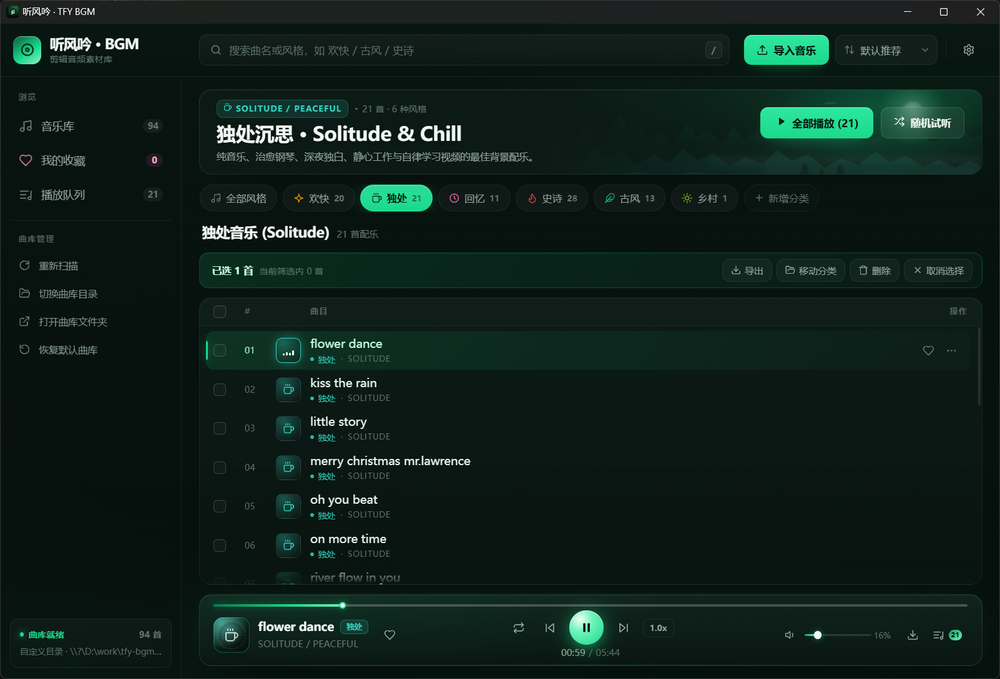
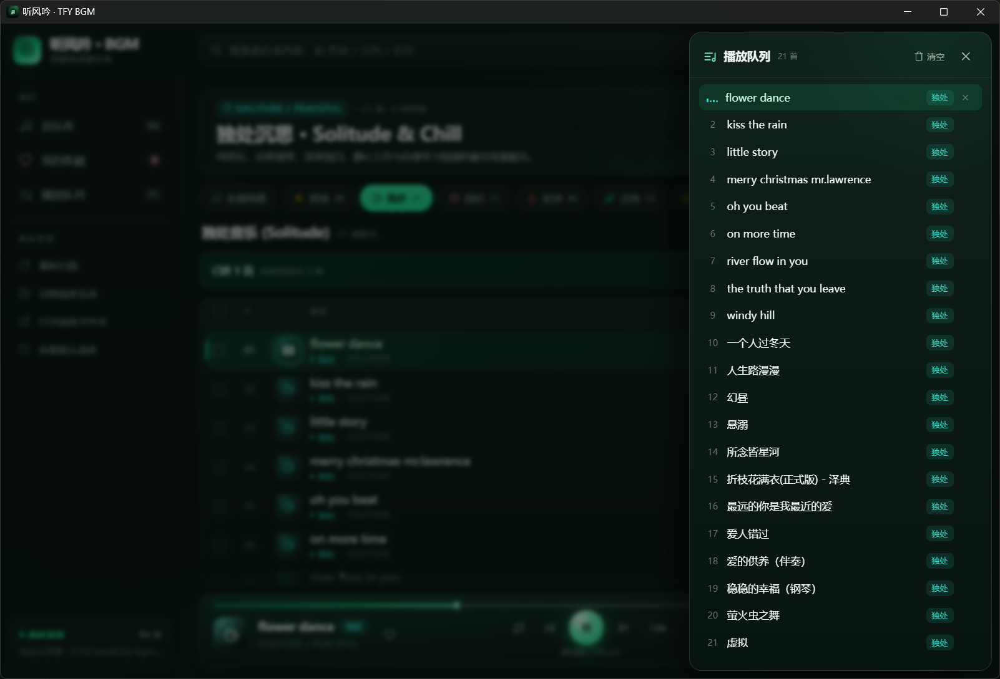

# 听风吟 · TFY BGM

专为视频剪辑打造的本地 BGM 音频素材库桌面客户端，基于 **Rust + Tauri 2** 构建。
分类扫描、收藏、检索、队列与全功能播放器全部在本地完成，离线可用；
界面为 `ui/` 下的 **Vite + Vue 3 + TypeScript**，业务逻辑集中在 Rust 核心库，前端只负责展示与 IPC。

---

## 🖼 界面预览

### 曲库主界面



> 截图为内置示例曲库：独处分类 21 首，播放器正在播放 `flower dance`。

界面自上而下、从左到右分为四个区域：

| 区域 | 内容 |
| :--- | :--- |
| **顶栏** | 品牌标识与副标题；搜索框（匹配曲名、中英文分类名与目录名，按 `/` 聚焦）；「导入音乐」；排序切换（推荐 / 按曲名）；界面壁纸（渐变 / 静态图 / MP4 动态壁纸）；设置齿轮（直接定位 `config.json`） |
| **左侧栏** | 浏览：音乐库、我的收藏、播放队列；曲库管理：重新扫描、切换曲库目录、打开曲库文件夹、恢复默认曲库；底部常驻显示曲库状态与当前目录 |
| **主区** | 当前分类横幅（中英文标题、描述、曲目数、「全部播放」「随机试听」）→ 风格筛选栏（显示各分类曲目数，含「＋ 新增分类」）→ 曲目列表（序号、曲名、分类标签、收藏与更多操作，勾选后浮出批量操作条） |
| **播放器** | 常驻底栏：封面、曲名与分类、收藏；循环模式、上一首 / 播放暂停 / 下一首、倍速档位；音量滑杆、导出音频、播放队列入口 |

### 播放队列



点击播放器右侧的队列按钮即可展开，面板浮于界面上方、背景自动虚化。
当前曲目高亮显示，点击任意一行直接切歌；每行末的 `×` 移除单曲，顶部「清空」清空整个队列，
两者都会二次确认，避免误操作。

---

## 📦 仓库结构

| 内容 | 位置 | 说明 |
| :--- | :--- | :--- |
| 曲库音频 | `bgm/<分类>/*.mp3` | 文件名即曲名；外置存放，不打进 exe / 安装包 |
| 内置壁纸 | `assets/bg/` | 随包壁纸：`1.mp4`（动态）+ `1.thumb.jpg` 缩略图 + `2.jpg`（静态），经 `bundle.resources` 打进安装包 |
| 设备无关核心库 | `src-tauri/core/` | 目录扫描、导入/重命名/移动/软删除、分类元数据、应用配置、偏好持久化、导出校验；可独立测试 |
| 分类默认模板 | `src-tauri/core/assets/categories.default.json` | 内置 6 个分类的默认文案与图标，编译期嵌入 |
| Tauri 应用层 | `src-tauri/src/` | 运行期状态、曲库根目录解析、命令与资源授权 |
| 前端 | `ui/` | Vite + Vue 3 + TypeScript；`pnpm run build` 产物 `ui/dist/` 由 Tauri 内嵌 |
| 应用打包配置 | `src-tauri/tauri.conf.json` | 窗口、CSP、Asset Protocol（音频不打包） |
| 打包脚本 | `scripts/` | 绿色版 / NSIS 安装包 / Linux deb·rpm，统一产物命名并生成 SHA-256 校验值 |
| CI | `.github/workflows/package.yml` | 推 `v*` 标签自动构建全平台产物并发布 Release |
| 权限 | `src-tauri/capabilities/default.json` | 仅授予 `core:default` |
| 图标 | `src-tauri/icons/` | 由 `app-icon.svg` 生成的各平台图标 |
| 界面截图 | `assets/` | README 使用的界面预览图，不参与打包 |

```
tfy-bgm.exe ──┬─ Rust 启动扫描 ──▶ LibrarySnapshot ──IPC──▶ Vue 3 界面
              └─ bgm/<分类>/*.mp3（exe 同级外置目录，不打进程序）
```

---

## 🗂 分类与目录规范

曲名直接取文件名（下划线 `_` 显示为空格），曲库内容完全由磁盘目录决定，
增删 / 替换 mp3 后重新扫描即可生效。

| 中文分类 | 目录名 | 适用剪辑场景 |
| :--- | :--- | :--- |
| **欢快** | `cheerful` | 生活 Vlog、开箱解说、美食探店、快节奏卡点 |
| **独处** | `solitude` | 深夜独白、治愈钢琴、学习工作、慢生活 |
| **回忆** | `memories` | 怀旧故事、毕业季、岁月光影、情感纪实 |
| **史诗** | `epic` | 燃向混剪、大片战歌、企业宣传、运动高光 |
| **古风** | `gufeng` | 国风雅韵、汉服文旅、仙侠武侠 |
| **乡村** | `country` | 乡野烟火、田园慢生活、度假风景 |

注册分类与展示文案以 `categories.json` 为准：首次启动会按内置模板生成该文件，
之后既可在界面中维护，也可直接用编辑器修改后点击「重新扫描」生效。
放入未注册目录（即 `categories.json` 中不存在的目录）或 `bgm/` 根目录的 mp3 会被忽略，并在界面上给出告警。

### 分类维护

- **编辑分类**：右键点击任意分类标签（或曲目行中的分类标签）→ 「编辑分类」，可修改显示名称与主题色；
  目录名与已导入的音频文件保持不变。
- **新增分类**：点击风格筛选栏末尾的「＋ 新增分类」，或右键分类 → 「新增分类」；可指定目录名（留空则使用分类名称），
  应用会同步在曲库根目录下创建同名文件夹，之后即可向该分类导入音频。
- **本地文件维护**：分类配置保存在应用配置目录的 `categories.json`（见下方「运行时配置文件位置」），
  右键菜单中的「打开分类配置文件」会在文件管理器中定位该文件；字段包括 `id`（目录名）、
  `nameZh`、`nameEn`、`labelEn`、`color`、`icon`（界面图标名）、`title`、`description`。
  缺失字段会自动补全，损坏或为空时回退为内置分类。修改文件后点击左侧栏「曲库管理 → 重新扫描」即可刷新。
  每次新增 / 编辑分类以及重新扫描时，应用都会先重新读取该文件，手工编辑不会丢失。

---

## ⚙️ 应用配置 config.json

品牌文案、界面文案与播放器行为参数都从应用配置目录的 `config.json` 读取。
首次启动会按内置默认值生成该文件；右键风格筛选栏 → 「打开应用配置文件」，或点击顶栏齿轮图标直接定位，
修改后点击左侧栏「重新扫描」热加载（窗口标题、标题栏与列表文案立即更新，无需重启）。

| 字段 | 说明 |
| :--- | :--- |
| `brand.title` | 顶栏品牌标题与文档标题 |
| `brand.subtitle` | 顶栏品牌副标题 |
| `brand.windowTitle` | 系统窗口标题，启动与热加载时应用 |
| `player.rates` | 倍速档位与循环顺序，如 `[0.75, 1, 1.25, 1.5, 2]` |
| `player.volumeStep` | `↑` / `↓` 与音量滑杆的步进 |
| `player.seekStepSeconds` | `←` / `→` 的跳转秒数 |
| `player.restartThresholdSeconds` | 当前曲目播放超过该秒数时，「上一首」先回到开头 |
| `player.maxAutoSkips` | 连续加载失败时最多自动跳过几首；`0` 表示不跳过 |
| `player.loadTimeoutMs` | 读取音频 Blob 的超时时间（毫秒） |
| `ui.all` / `ui.favorites` | 「全部」「收藏」页的 `title`、`labelEn`、`description`、`resultsTitle` |

`ui.*.description` 支持 `{categories}` 占位符，会替换为当前分类名称（以「、」连接）。
所有取值都会被自动收敛：空文案回退默认、数值夹到安全区间、倍速去重并限制在 `0.25`–`4.0`；
文件损坏时回退内置默认值，并在界面提示。

### 曲库根目录解析顺序

1. 环境变量 `TFY_BGM_DIR`（适合开发与可移动硬盘）；
2. 界面上「切换曲库目录」选择并持久化的文件夹；
3. 开发模式（debug）下的仓库根目录 `bgm/`；
4. **exe 同级的 `bgm/`**（绿色版默认曲库位置）；
5. 当前工作目录下的 `bgm/`；
6. 应用配置目录 `%APPDATA%\com.yuanjie.tfybgm\bgm`。

外置目录不存在时，程序会优先在 exe 同级创建 `bgm/` 并补齐分类子目录；若该位置不可写，则退到应用配置目录。
音频始终在外部，替换 / 增删文件后点「重新扫描」即可，无需重新打包。

左侧栏「曲库管理」可随时「重新扫描」「切换曲库目录」「打开曲库文件夹」；使用自定义目录时可「恢复默认曲库」。

---

## ✨ 功能

1. **本地曲库与分类检索**
   - 内置 6 个分类（可右键编辑名称与主题色、用 `＋` 新增自定义分类）、收藏夹、实时搜索（曲名 / 中英文分类名 / 目录名）。
   - 两种排序：推荐（默认）与按曲名（`Intl.Collator` 中文排序）。
   - 「推荐」排序下可拖动行调整顺序（仅内存，不写盘）。
2. **曲库文件管理（CRUD）**
   - **分类**：右键分类标签或曲目分类标签编辑名称 / 主题色，`＋` 或右键菜单新增分类，
     右键菜单可直接打开本地 `categories.json` 配置文件。
   - **新增**：顶部「导入音乐」选择多个 mp3，复制到指定分类目录；同名自动追加序号，不覆盖已有文件。
   - **编辑**：行内编辑曲名与分类；曲名变化会重命名文件，分类变化会移动文件，收藏 key 自动跟随。
   - **右键菜单**：曲目行支持播放、顺序播放、随机播放、收藏 / 取消收藏、重命名文件、修改分类、
     导出音频与删除；多选时对所选曲目执行收藏、移动分类、导出与删除。
   - **删除**：单首或批量删除为软删除，文件移动到曲库根目录的 `.tfy-trash/<批次>/`，可手动恢复。
   - **批量**：表头全选/单选/Shift 连选，批量导出、批量移动分类、批量删除。
3. **音频导出**
   - 每首曲目与播放器均可导出 mp3，弹出系统原生保存对话框。
   - 多选后可批量导出到指定文件夹，同名自动追加序号。
   - 复制后校验落盘字节数与源文件一致，失败会清理不完整文件。
4. **全功能播放器**
   - 播放 / 暂停、上一首 / 下一首、顺序 / 单曲 / 随机。
   - 默认 0.75x / 1.0x / 1.25x / 1.5x / 2.0x 倍速档位（可在 `config.json` 调整）。
   - 高精度进度条：悬停时间预览，按住拖动 Seek；缓冲进度显示。
   - 音量滑杆、静音、播放队列抽屉（单曲移除与清空均带二次确认）、当前曲目收藏。
   - 音频经 Asset Protocol 读取后以 Blob 播放，兼容 Linux WebKitGTK 的媒体管线。
   - 加载失败自动跳过（最多连续 3 首）并提示原因，失败时会停下来而不会无限循环切歌。
5. **收藏与偏好持久化**
   - 收藏、音量、静音、倍速、播放模式、排序由 Rust 写入应用配置目录的 `prefs.json`。
   - 收藏使用稳定键 `分类/文件名主干`；重命名 / 移动分类时收藏自动迁移，替换同名文件不会丢失收藏。
6. **界面壁纸**
   - 顶栏调色板按钮可切换：默认样式、渐变蓝 / 绿 / 红，以及随包内置的两款壁纸（`assets/bg/1.mp4` 动态壁纸、`assets/bg/2.jpg` 雪山静态壁纸）。
   - 支持本地自定义壁纸：`jpg / jpeg / png / webp` 静态图与 `mp4` 动态壁纸，经系统文件对话框选择，路径写入 `prefs.json`。
   - 动态壁纸用静音循环的 `<video>` 铺满窗口，标签页隐藏时自动暂停；壁纸层压在面板下方，面板保持半透明毛玻璃，文字对比度不受影响。
   - 内置壁纸打包进安装包（`tauri.conf.json` 的 `bundle.resources`），资源缺失时对应选项自动隐藏。
7. **配置化与可维护性**
   - 品牌文案、界面文案、播放器行为参数集中在 `config.json`，分类文案与图标由 `categories.json` 维护。
   - 前端事件名、Tauri 命令名、播放模式等契约字符串统一收敛在 `js/constants.js`，
     内置分类模板位于 `core/assets/categories.default.json`，修改文案不需要改代码。
8. **桌面体验**
   - 运行时不依赖 Node / pnpm（前端在构建期打包），离线可用；音频由 Tauri Asset Protocol 从本地曲库读取后播放。
   - 中文本地字体栈，不请求任何远程字体或第三方资源。

### 键盘快捷键

| 按键 | 功能 |
| :--- | :--- |
| `空格` | 播放 / 暂停（未播放时从当前列表第一首开始） |
| `←` / `→` | 后退 / 前进（默认 5 秒，可在 `config.json` 调整） |
| `↑` / `↓` | 音量 +10% / -10%（步进可配置） |
| `M` | 静音 / 恢复 |
| `/` | 聚焦搜索框并选中当前关键词 |
| `Enter` | 搜索框内确认并退出输入（不影响中文输入法上屏） |
| `Esc` | 关闭队列抽屉；清除批量选择；搜索框内清空搜索 |

---

## 🚀 开发与构建

### 环境要求

- Rust **1.90+**（`rustup` 安装稳定版即可）。
- **Node.js 20+ 与 pnpm 11**：仅构建期需要，用于 Vite + Vue 3 + TypeScript（推荐 `corepack enable` 启用 pnpm）。
- Tauri 2 桌面依赖：
  - **Fedora**
    ```bash
    sudo dnf install webkit2gtk4.1-devel gtk3-devel libsoup3-devel \
      javascriptcoregtk4.1-devel openssl-devel librsvg2-devel \
      libappindicator-gtk3-devel gcc gcc-c++ pkgconf-pkg-config
    ```
  - **Debian / Ubuntu**
    ```bash
    sudo apt install libwebkit2gtk-4.1-dev build-essential curl wget file \
      libxdo-dev libssl-dev libayatana-appindicator3-dev librsvg2-dev
    ```
  - **macOS**：Xcode Command Line Tools。
  - **Windows**：Rust MSVC toolchain + Visual Studio Build Tools（勾选「使用 C++ 的桌面开发」）+ WebView2 Runtime（Win10/11 一般已预装）。
- 音频由系统 WebView 解码，Linux 上如遇无声 / 无法拖动进度，请补装 GStreamer 插件：
  `sudo dnf install gstreamer1-plugins-good gstreamer1-plugins-ugly`（Debian/Ubuntu 对应 `gstreamer1.0-plugins-good` / `-ugly`）。

### 启动开发版

先在仓库根目录安装前端依赖：

```bash
corepack enable            # 首次使用 pnpm 时
pnpm install               # 安装根工作区与 ui/ 的全部依赖
```

然后任选一种方式启动：

```bash
# 方式一：Rust 原生 CLI（推荐，首次需安装）
cargo install tauri-cli --version "^2" --locked
cd src-tauri && cargo tauri dev

# 方式二：官方 CLI（仓库根目录执行）
pnpm dlx @tauri-apps/cli@^2 dev
```

`tauri.conf.json` 已配置：

- `beforeDevCommand: "pnpm run dev"` — Tauri 自动启动 Vite（`http://localhost:1420`），Vue 组件改动热更新；
- `beforeBuildCommand: "pnpm run build"` — 打包前自动执行 `vue-tsc` 类型检查与 Vite 生产构建；
- `frontendDist: "../ui/dist"` — 生产产物目录。

Rust 改动仍由 Tauri 自动重编译；只改前端时热更新即可，不需要重启窗口。

### 打包与分发

音频不进入 exe，也不进入安装包；程序运行时从外置 `bgm/` 读取。
绿色版包里的 `bgm/` 与 exe 并排，属于外置文件，整个文件夹可以替换或删除。

#### 方式一：绿色版（exe + 外置 bgm，推荐）

只编译 exe（不需要 Tauri CLI，但要先构建前端）：

```powershell
pnpm run build
cd src-tauri
cargo build --release
```

产物为 `src-tauri/target/release/tfy-bgm.exe`。手动放置时，在它同级放一个 `bgm/` 目录（首次启动也会自动创建并补齐分类子目录）：

```
tfy-bgm/
  tfy-bgm.exe
  bgm/
    cheerful/
    solitude/
    memories/
    epic/
    gufeng/
    country/
```

更推荐从仓库根目录一键组装并压缩，**默认会把仓库的 `bgm/` 一起复制**，解压即带曲库：

```powershell
# 自带曲库的绿色版（约 350 MB）
powershell -ExecutionPolicy Bypass -File scripts/package-portable.ps1

# 只要空曲库的精简包（约 3.7 MB），启动后自己指定曲库目录
powershell -ExecutionPolicy Bypass -File scripts/package-portable.ps1 -EmptyBgm
```

产物：

```
dist/
  tfy-bgm-1.0.0-windows-x64-portable.zip   ← 对外分发这个
  SHA256SUMS.txt                           ← SHA-256 校验值
  tfy-bgm/                                 ← 组装目录（exe + bgm\），可直接运行调试
```

打包脚本的几条约定：

- 构建前会先执行 `pnpm run build`（需要 Node.js 20+ 与 pnpm），确保 `ui/dist` 与 exe 同批次更新。
- `-WithBgm` 仍可传入，等同于默认行为。
- 重复打包只更新 exe / 说明文件，会保留 `dist\tfy-bgm\bgm` 里已有的曲库；需要从仓库重新同步时，先删除该 `bgm` 目录。
- `-EmptyBgm` 检测到已有 mp3 时会拒绝执行，避免误删曲库。
- `-SkipBuild` 复用 `src-tauri\target\release\tfy-bgm.exe`，只重新组装与压缩；`-NoZip` 只组装不打 zip。
- 检测到 `dist\tfy-bgm` 下的程序正在运行时会提示先关闭，避免覆盖失败。
- zip 内是单层 `tfy-bgm/` 目录，解压后直接得到 `tfy-bgm.exe` 与 `bgm/`；空曲库包也会保留分类空目录。条目分隔符按规范写成 `/`，中文名按 UTF-8 存储并置 UTF-8 标志位，跨平台解压不乱码。
- `dist\` 里旧版本的产物不会自动清理，`SHA256SUMS.txt` 也只覆盖当前版本，发版前顺手删掉旧文件，避免误传。

目标机器需要 WebView2 Runtime（Windows 10/11 通常已自带；缺失时安装微软官方运行时即可）。

#### 方式二：NSIS 安装包

```powershell
cargo install tauri-cli --version "^2" --locked   # 首次安装

# 构建 + 归档到 dist\tfy-bgm-<版本>-windows-x64-setup.exe
powershell -ExecutionPolicy Bypass -File scripts/package-installer.ps1
```

脚本内部执行 `cargo tauri build --bundles nsis`，再把产物复制成规范名。`-SkipBuild` 可复用已有构建，但要求产物版本号与 `tauri.conf.json` 一致，避免把旧版本改名当成新版本发出去。

安装包不包含音频，体积与普通桌面应用相当；默认按当前用户安装到可写目录，首次启动会在 exe 同级创建 `bgm/`，也可通过「切换曲库目录」指向任意位置。

> 直接 `cargo tauri build`（不带 `--bundles`）会按 `targets: "all"` 尝试 NSIS 与 MSI；MSI 依赖 WiX，日常分发用 NSIS 即可。

#### 方式三：Linux 安装包（deb / rpm）

deb / rpm 无法在 Windows 上交叉构建，需在 Linux 上执行（或放进 CI 矩阵）：

```bash
bash scripts/package-linux.sh                    # 默认两种都打
bash scripts/package-linux.sh deb                # 只打指定格式
SKIP_BUILD=1 bash scripts/package-linux.sh rpm   # 复用已有构建
```

产物：

```
dist/tfy-bgm-1.0.0-linux-amd64.deb
dist/tfy-bgm-1.0.0-linux-x86_64.rpm
```

- **不需要 Fedora，也不需要 `rpmbuild`**：`deb` 与 `rpm` 都由 Tauri 内置的纯 Rust 打包器直出（deb 用 `flate2` + `tar`，rpm 用 `rpm` crate），全程不调用 `dpkg-deb` / `rpmbuild`。只要这台机器能编译 Tauri（装好「环境要求」里的 WebKitGTK 依赖），两种包都能打。
- 在 Ubuntu 24.04 上构建，产物要求 **glibc ≥ 2.39**（Ubuntu 24.04+ / Debian 13+ / Fedora 40+）；更老的发行版不在支持范围内。
- 想在 Fedora 上验证安装效果，可以 `podman run --rm -it -v $PWD/dist:/mnt fedora:latest dnf install -y /mnt/tfy-bgm-*.rpm`。
- 首次需 `cargo install tauri-cli --version "^2" --locked`。
- rpm 文件名去掉了 release 段以保持四段统一，包内元数据仍是 `Release: 1`；将来若直接拿构建目录里的产物做 dnf 仓库，原名也仍然可用。

#### 产物命名规范

统一为 `tfy-bgm-<版本>-<平台>-<架构>[-<类型>].<扩展名>`：

| 平台 | 文件 |
| --- | --- |
| Windows 绿色版 | `tfy-bgm-1.0.0-windows-x64-portable.zip` |
| Windows 安装版 | `tfy-bgm-1.0.0-windows-x64-setup.exe` |
| Linux DEB | `tfy-bgm-1.0.0-linux-amd64.deb` |
| Linux RPM | `tfy-bgm-1.0.0-linux-x86_64.rpm` |

- 版本号唯一来源是 `src-tauri/tauri.conf.json`，脚本会校验 `Cargo.toml` 的 `[package].version` 是否一致，不一致直接报错，避免产物名与实际版本脱节。
- 架构按平台惯例：Windows `x64` / `arm64`，deb `amd64` / `arm64`，rpm `x86_64` / `aarch64`——三者指同一架构，不要写成 `64bit`。
- rpm 官方命名是 `name-version-release.arch.rpm`，这里按要求统一成四段；`Release` 保留在包元数据里，`createrepo` 读的是 header，改名不影响索引。
- `SHA256SUMS.txt` 与 `sha256sum -c` 兼容（小写十六进制、两个空格、LF 换行），Windows 与 Linux 产物可以写进同一份。

#### 用 GitHub Actions 打包

`.github/workflows/package.yml` 分 4 个 job：`guard` 校验标签版本 → `windows` / `linux` 测试并打包 → `release` 发布，产物命名与本地脚本完全一致：

```bash
git tag v1.0.0
git push origin v1.0.0
```

推 `v*` 标签会构建全平台并自动创建 Release，附上全部产物和一份合并的 `SHA256SUMS.txt`；标签名（去掉 `v`）必须等于 `tauri.conf.json` 的 `version`，否则 `guard` 直接失败，不会白跑两套构建。

也可以在 Actions 页面手动 `Run workflow`，只构建不发布，产物在运行页面底部下载。手动触发时可选 `empty-library` 跳过曲库：仓库里 `bgm/` 约 350 MB，带曲库的 zip 有 346 MB，私有仓库会明显消耗 Actions 存储配额。

几点说明：

- `guard` 和 `release` 跑 `ubuntu-slim`（1 核容器，分钟数远低于 4 核 VM）；打包必须用完整 VM——slim 镜像里没有 gcc 与 WebKitGTK、容器是非特权的、单 job 还有 15 分钟上限，Tauri 全量编译一定超时。
- artifact 只保留 3 天（`retention-days: 3`），346 MB 的包不会长期占着存储。
- Linux 用 `ubuntu-24.04`，产物只支持 glibc ≥ 2.39 的系统（Ubuntu 24.04+ / Debian 13+ / Fedora 40+），更老的发行版不在支持范围内。
- 打包不依赖任何 deb/rpm 工具链，workflow 里的 apt 步骤只装编译依赖（WebKitGTK 等）。
- `tauri-cli` 用 `cargo install` 装一次，`~/.cargo/bin` 与 `.crates.toml` 走缓存，命中后直接跳过编译。
- 工作流只在 GitHub 上生效；当前 `origin` 是 Gitee，需要先推到 GitHub 镜像仓库才会触发。

---

## 🧪 测试与检查

```bash
cd src-tauri

cargo test -p bgm-core                 # 扫描 / 偏好 / 导出单元测试
cargo clippy -p bgm-core --all-targets -- -D warnings
cargo fmt --all -- --check
cargo check --workspace                # 需要上面的 WebKitGTK 等系统依赖
```

`bgm-core` 不依赖 Tauri，可在无图形依赖的环境（如 CI 容器）里独立测试业务逻辑。

---

## 🔐 架构与安全

- **状态与命令**：`AppState` 持有偏好（`parking_lot::RwLock`）与最近扫描结果；
  前端只能通过命令读取快照、保存偏好、切换 / 扫描曲库、导入 / 编辑 / 移动 / 删除曲目与导出音频。
- **偏好校验**：前端提交的偏好会经过 `Prefs::normalize_with_rates`（音量 clamp、
  倍速白名单取自 `config.json` 的 `player.rates`、收藏去重与长度限制）；
  曲库目录只能由专门命令修改，普通偏好保存不能覆盖。
- **应用配置**：`config.json` 的品牌文案、数值参数与 `ui` 文案都会经过
  `AppConfig::normalize`；空文案回退默认、数值 clamp 到安全区间、倍速去重并限制在 `0.25`–`4.0`。
  窗口标题由配置驱动，热加载失败只提示告警，不影响曲库使用。
- **分类配置**：新增 / 编辑分类由 Rust 校验名称与目录名必须是单个普通路径分量，
  主题色必须是 `#RRGGBB`，同名分类与重复目录名会被拒绝；配置写入应用配置目录的
  `categories.json`，手工编辑后重新扫描生效。
- **最小权限**：`capabilities/default.json` 仅启用 `core:default`。
  原生文件夹选择、保存对话框与「打开目录」全部在 Rust 侧调用插件，不向 WebView 暴露插件权限。
- **资源授权**：Asset Protocol 仅授权当前曲库根目录（递归），可播放路径限定在扫描结果内。
- **CSP**：默认仅允许本地脚本 / 样式，`media-src` 允许 `asset:` 与 `http://asset.localhost`，
  不加载远程脚本、字体或图片。
- **写操作安全**：前端只能提交曲库快照中的 key 与分类 id；实际路径由 Rust 用
  「曲库根目录 + 注册分类 + 文件名」重新推导，并校验文件名必须是单一普通路径分量，
  拒绝路径穿越；重命名冲突直接报错，不覆盖已有音频。
- **导出安全**：导出目标由系统保存对话框确定；复制后做大小校验，源路径由曲库快照推导而非前端路径。
- **删除可恢复**：删除采用软删除，文件移动到 `<曲库根>/.tfy-trash/<批次>/`，
  扫描器忽略该隐藏目录；批量删除前会弹出系统确认对话框。

### 运行时配置文件位置

由 Tauri `app_config_dir` 决定，三个文件并列存放：
`config.json`（品牌/文案/播放参数）、`prefs.json`（偏好）、`categories.json`（分类）。

- Linux：`~/.config/com.yuanjie.tfybgm/`
- macOS：`~/Library/Application Support/com.yuanjie.tfybgm/`
- Windows：`%APPDATA%\com.yuanjie.tfybgm\`

任一文件损坏或缺失时都会回退为对应默认值，不会阻止应用启动；
`config.json` 与 `categories.json` 修改后可点「重新扫描」热加载，`prefs.json` 由应用自行维护。

---

## 📄 许可与免责声明

- 代码与文档采用 **Apache License 2.0** 授权（见 `LICENSE`，Copyright 2026 YuanJie）。
- **音频素材版权归原权利人所有**。本仓库不附带任何音频授权，
  `bgm/` 下的 mp3 不属于 Apache-2.0 授权范围。
- 素材仅供个人学习与剪辑练手；商业发布前请自行向版权方取得授权。