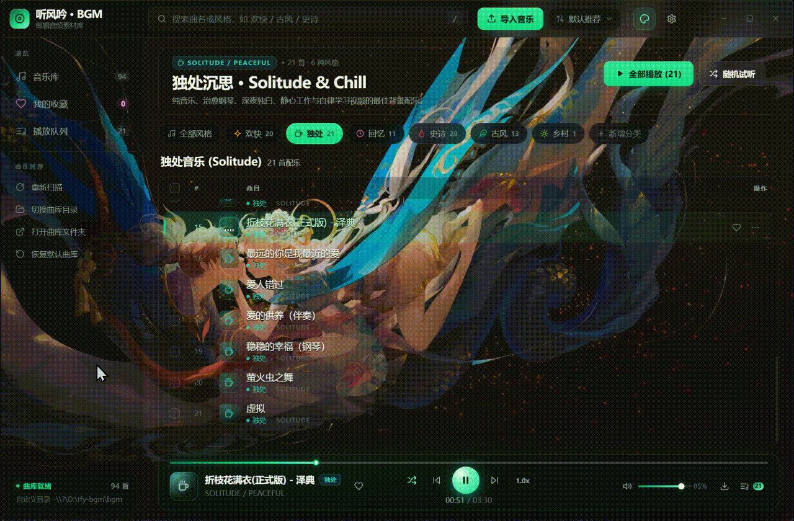
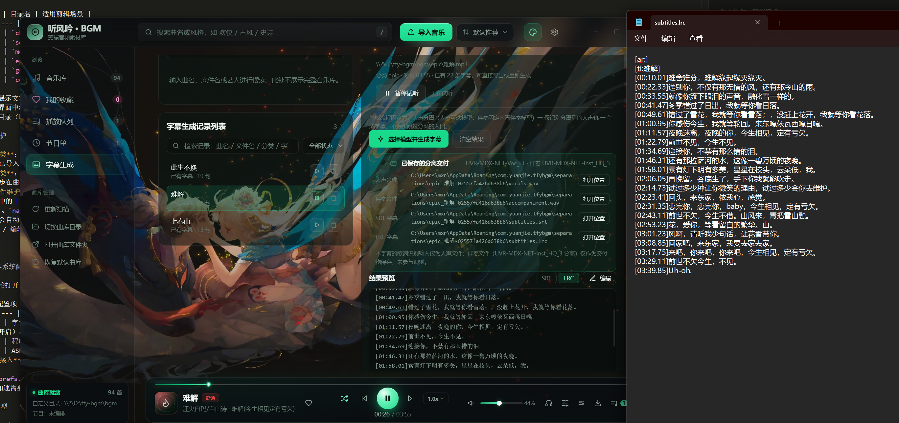
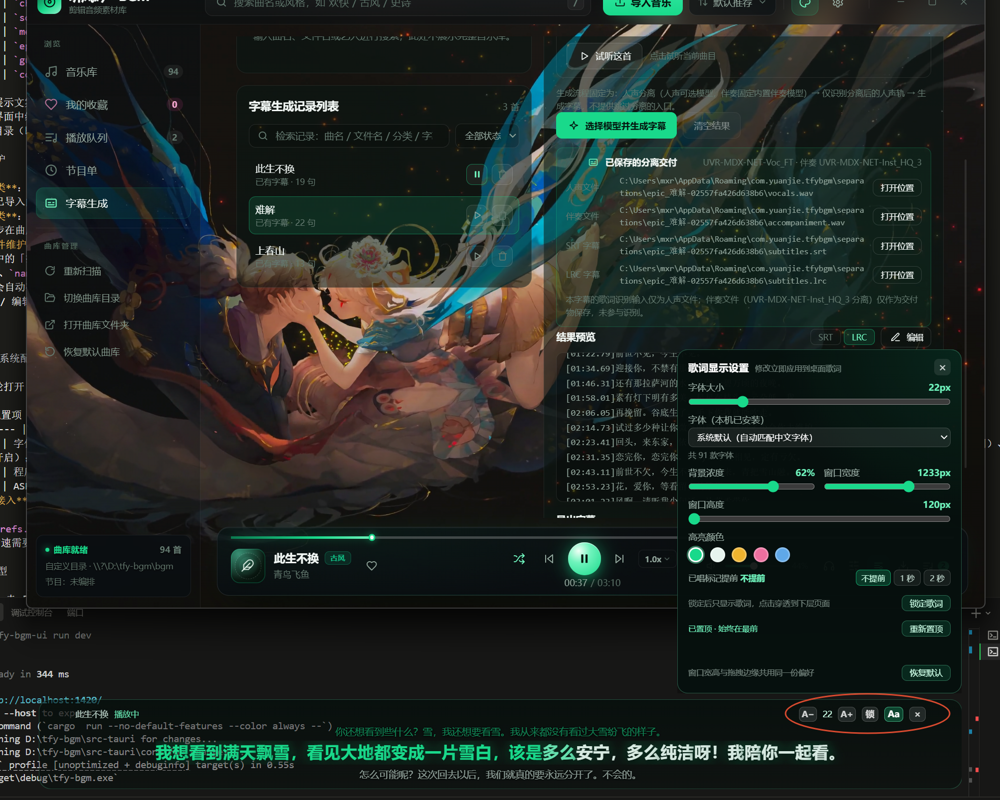
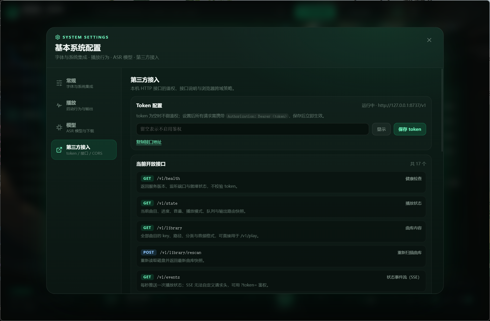
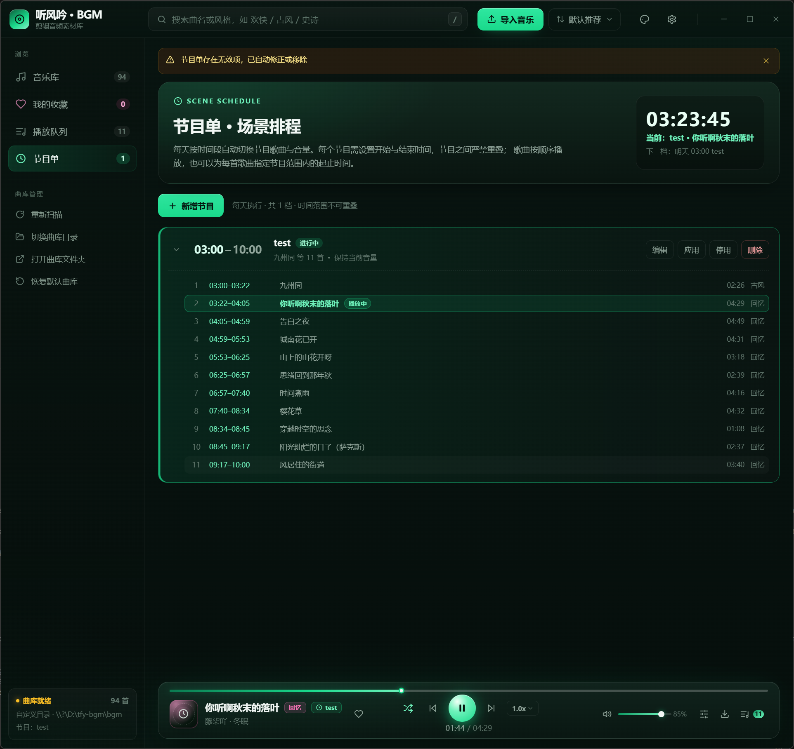

# 听风吟 · TFY BGM

面向视频剪辑的本地 BGM 素材库与试听客户端，**Rust + Tauri 2** 桌面端，界面为 **Vite + Vue 3 + TypeScript**。

曲库扫描、分类维护、收藏检索、播放队列、节目单排程、字幕生成、可视化诊断与音频导出全部在本地完成，
离线可用；曲库目录由系统级文件监听自动同步，无需手动重扫。支持 **mp3 / m4a / flac / wav / ogg**，
切歌可交叉淡入淡出，同一路音乐可同时送到多个输出设备并独立调音量。

字幕工作流先分离人声与伴奏，再仅对分离后的人声轨调用 ASR，产出可编辑的 **SRT / LRC**，
并以透明置顶窗口逐词显示桌面歌词。另提供本机 HTTP 接口（`127.0.0.1:8737`，9 类 33 个接口，
含长任务 SSE），供 OBS、Stream Deck、直播脚本等外部项目接入控制。

> 音频素材始终外置在 `bgm/`，不进入可执行文件；人声分离模型随安装包分发（绿色版需自行放置 `models/`）。

---

## 🖼 界面预览

### 曲库主界面



| 区域 | 内容 |
| :--- | :--- |
| **顶栏** | 品牌标识与副标题；搜索（曲名 / 中英文分类名 / 目录名，`/` 聚焦）；导入音乐；排序；界面壁纸；设置 |
| **左侧栏** | 音乐库、我的收藏、播放队列、节目单、**字幕生成**；曲库管理（重新扫描 / 切换目录 / 打开文件夹 / 恢复默认）；底部曲库状态与当前节目 |
| **主区** | 分类横幅（中英文标题、描述、曲目数、全部播放 / 随机试听）→ 风格筛选（含「＋ 新增分类」）→ 曲目列表（喜欢、分类标签、批量操作条、右键菜单）；切换节目单或字幕生成时替换为对应页面 |
| **播放器** | 封面（打开可视化诊断）、曲名跑马灯、艺人 / 专辑、当前节目标签、收藏、循环点；播放模式、上一首 / 播放 / 下一首、倍速；音量、播放输出、导出设置、**桌面歌词**、导出音频、队列入口 |

### 字幕生成



- 音乐选择区只提供搜索、不加载整库；点选结果，或在曲库中右键曲目 / 「更多」→「字幕生成」加入记录列表，列表内可试听、可移出。
- 生成前必须在弹窗确认人声分离模型；伴奏固定为随包的 `UVR-MDX-NET-Inst_HQ_3`，只展示、不可更改。
- 完成后列出「分离交付」：`vocals.wav`、`accompaniment.wav`、`subtitles.srt`、`subtitles.lrc`，每项可在文件管理器中定位。
- 结果预览可切换 SRT / LRC、进入分段编辑或原文编辑；保存后预览、导出与已开启的桌面歌词立即同步。
- 记录列表有独立检索与状态筛选（全部 / 已生成 / 待生成）；匹配曲名、文件名、分类、艺人 / 专辑与字幕正文。

### 桌面歌词



- 独立透明置顶窗口，当前行按词连续混色、随播放进度推进，并显示上一行 / 下一行。
- 工具栏常驻 `A−` / 字号 / `A+` / 锁定 / `Aa`；`Aa` 打开贴条设置窗，可调字号 12–64px、系统字体、背景浓度、窗口宽高（420–1600 × 120–900）、高亮色与「已唱标记提前」0 / 1 / 2 秒。
- 默认 760×120、贴屏幕底部居中；样式与尺寸保存在窗口本地，重开仍生效；窗口每 3 秒校验置顶，也可手动「重新置顶」。
- 点击悬浮窗「×」或用 Alt+F4 关闭、以及释放模型，都会清除歌词开关；正常退出应用不会。
- 仅在 ASR 模型加载成功后可用；未加载时开关禁用并提示先完成模型加载。

### 基本系统配置



| 分组 | 配置项 |
| :--- | :--- |
| **常规** | 系统字体、开机自动启动、最小化托盘、GPU 加速；Windows 另含 SMTC（默认关）、系统空间音效（默认关）、系统音频增强（默认开）；Linux 另含 MPRIS2（默认关，仅 Wayland 会话） |
| **播放** | 启动时自动播放、播放时不息屏、音乐淡入淡出、输出设备列表与每路音量 / 静音 |
| **模型** | ASR 模型目录与下载、`.onnx` 自动扫描、加载 / 释放 / WAV 试识别；人声分离模型随包提供，自定义模型放 `模型目录/separation/` |
| **第三方接入** | API token、当前接口清单、CORS 策略（仅本机 / 允许所有来源 / 自定义来源） |

### 播放队列 · 节目单 · 可视化诊断

**播放队列**：右侧浮动面板，当前曲目高亮并带跳动电平；单曲移除与清空均二次确认。


**节目单**：每日时段时间轴，顶部显示当前与下一档节目；节目行可展开歌曲，「编辑」就地展开，不跳离时间轴。



**可视化诊断**：点击播放器封面打开，整曲波形 + 实时频谱 + 响度 / 峰值仪表 + 可用性结论。


---

## ✨ 功能

| 模块 | 关键能力 |
| :--- | :--- |
| **曲库与检索** | 目录即分类；6 个内置分类可改名称 / 主题色 / 新增；收藏夹（重命名 / 移动自动迁移）；实时搜索；推荐与按曲名排序 |
| **文件管理** | 导入、行内重命名与移动、批量操作；删除为软删除，文件移至 `.tfy-trash/<批次>/`，可手动恢复 |
| **播放器** | 顺序 / 单曲 / 智能随机；0.75–2.0 倍速；采样级 A/B 循环；交叉淡入淡出；加载失败自动跳过 |
| **多设备输出** | 同一路混音同时送到多个物理设备，每路独立音量与静音；不支持 `setSinkId` 时回退为系统默认输出 |
| **节目单** | 每日时段编排、逐曲起止时间、拖拽排序、自动排期；重叠拦截与到点执行 |
| **字幕生成** | 人声分离 → 仅识别人声轨 → SRT / LRC；记录检索、分段 / 原文编辑、分离交付文件 |
| **桌面歌词** | 透明置顶、逐词混色、已唱标记提前；字体 / 字号 / 颜色 / 窗口尺寸可调 |
| **音频导出** | 默认 -14 LUFS 归一化，四档目标；ffmpeg 两遍 `loudnorm`；失败回退源格式复制并说明原因 |
| **可视化诊断** | 整曲波形、72 段频谱、LUFS / 峰值仪表、削波与相位相关、可用性结论 |
| **实时监听** | `notify` 递归监听 + 700ms 防抖 + 30 秒兜底；标签与时长按「路径 + 大小 + 修改时间」缓存 |
| **系统集成** | 系统字体扫描、开机自启、托盘、Windows SMTC / 空间音效 / 音频增强、Linux MPRIS2、GPU 加速 |
| **界面壁纸** | 内置渐变、静态图与 MP4 动态壁纸；支持本地 jpg / png / webp / mp4 |
| **本机接口** | 9 类共 33 个 HTTP 接口（播放 / 曲库 / 字幕 / 人声分离 / 模型 / 长任务等）+ 标准 SSE 事件流；Bearer token；CORS 三档策略 |

### 字幕生成流程

流程固定为「人声分离 → 仅识别分离后的人声轨 → 生成字幕」，不提供跳过分离的入口：

1. ffmpeg 把源音频（MP3 / FLAC / M4A / OGG / WAV）解码为 44.1 kHz 双声道浮点 PCM。
2. 分离引擎在独立子进程中运行（模型不兼容时只影响该子进程）。人声由所选模型分离，伴奏固定使用随包 UVR 乐器模型；常规时长两路并行，超过 10 分钟改为串行以控制峰值内存。交付写入 `separations/<曲目 key 前缀>-<哈希>/`，两个 WAV 未成功落盘时立即停止，不回退原始混音。
3. 只对人声轨归一化为 16 kHz 单声道，按约 10 秒切片；切点在目标点前后 2.5 秒内吸附到能量最低的 20 ms 帧，避免把词切成两半。
4. 逐段调用已加载的 ASR 模型，结果格式化为 SRT / LRC，按曲目 key 持久化到 `subtitles/`，同目录另写 `subtitles.srt` 与 `subtitles.lrc`。

自定义分离模型必须为 sherpa-onnx 兼容的 2-stem 模型，使用前校验 `model_type`、`stems=2` 与必需元数据；未确认模型时不会开始分离。模型未加载、缺少 ffmpeg、解码失败或 ASR 无结果都会给出明确错误。

结果编辑支持「分段编辑」（逐条改文字与起止时间，可插入 / 删除）与「原文编辑」。保存时后端校验时间合法性、折叠换行并校验单句长度；SRT 兼容缺失序号与 `MM:SS,mmm` 简写，LRC 兼容元数据标签（`[offset:]` 仅忽略、不参与计时）与一行多时间戳，无法识别的时间轴会指出行号且不写盘。

### 播放与输出

- **智能随机**：同艺人 / 同专辑不连续，收藏与同风格加权，45 分钟内播过的曲目降权，长曲之后避免接短曲。
- **交叉淡入淡出**：旧声部按设定时长（0–12 秒）淡出、新声部同时淡入；自然播完切歌同样生效，暂停 / 恢复有 80ms 短淡出防爆音。
- **多设备路由**：首次使用需一次音频设备授权（应用不录音，拿到列表后立即释放音轨）；输出路由与每路音量写入 `prefs.json`。
- **失败处理**：连续加载失败默认最多跳过 3 首，超过后停下并提示原因，不会无限切歌。

### 节目单规则

- 节目按本地时间每天执行，结束必须晚于开始且不能跨天；节目之间时间范围严禁重叠，前端保存前校验、后端写入时再次拒绝。
- 保存或启用后立即按当前时间对齐；时段内拦截音乐库手动点播，当前歌曲播完后只循环本时段到点的歌曲。
- 每首歌可单独设置节目范围内的起止时间；拖拽排序后时间槽按位置重分配，「自动排期」按歌曲时长重新铺满时段。
- 「添加歌曲」通过「歌单 → 歌曲」树形弹窗搜索与多选，节目内已用歌曲自动排除；单曲可原位替换，保持原位置与时间不变。
- 每秒校验系统时间；窗口最小化导致定时器节流时回看最近 2 分钟，休眠恢复后对齐当前节目里最晚一首已开始的歌。

### 导出与响度归一化

- 默认按 **视频剪辑**（-14 LUFS）归一化，可切换 **播客 / 访谈**（-16）、**专注 / 冥想**（-20）、**广播 / 影视**（-23），真峰值与响度范围随目标同步调整。
- ffmpeg 按 `TFY_FFMPEG` → exe 同级目录 → `PATH` 查找；两遍 `loudnorm` 统一电平，实测同一素材在 -14 与 -20 目标下相差约 6 LU。
- 仅 mp3 目标且 ffmpeg 可用时转码归一化；关闭归一化、缺少 ffmpeg 或目标改回源格式时按源格式复制，避免扩展名与内容不符。
- 支持多选批量导出到指定文件夹，同名追加序号；复制后校验落盘字节数，失败会清理不完整文件。

### 键盘快捷键

| 按键 | 功能 |
| :--- | :--- |
| `空格` | 播放 / 暂停（未播放时从当前列表第一首开始） |
| `←` / `→` | 后退 / 前进（默认 5 秒，可在 `config.json` 调整） |
| `↑` / `↓` | 音量 +10% / -10%（步进可配置） |
| `M` | 静音 / 恢复 |
| `/` | 聚焦搜索框并选中当前关键词 |
| `Enter` | 搜索框内确认并退出输入（不影响中文输入法上屏） |
| `Esc` | 关闭诊断面板 / 队列抽屉；清除批量选择；搜索框内清空搜索 |

---

## 📦 仓库结构

| 内容 | 位置 | 说明 |
| :--- | :--- | :--- |
| 曲库音频 | `bgm/<分类>/*.{mp3,m4a,flac,wav,ogg}` | 文件名即曲名；外置存放，不打进 exe / 安装包 |
| 内置壁纸 | `assets/bg/` | `1.mp4`（动态）+ `1.thumb.jpg` + `2.jpg`（静态），经 `bundle.resources` 打包 |
| 随包分离模型 | `models/` | UVR 人声 / 伴奏 ONNX 与 Spleeter 归档（约 174 MB），经 `bundle.resources` 打进安装包；开发模式直接读该目录 |
| 设备无关核心库 | `src-tauri/core/` | 目录扫描、标签解析与缓存、文件操作、分类、配置、节目单与循环点持久化、导出与响度归一化；可独立测试 |
| 分类默认模板 | `src-tauri/core/assets/categories.default.json` | 6 个内置分类的默认文案与图标，编译期嵌入 |
| Tauri 应用层 | `src-tauri/src/` | 运行期状态、曲库根目录、文件监听、本机 API、字幕与桌面歌词、人声分离、字体扫描与系统设置 |
| 前端 | `ui/` | Vite + Vue 3 + TypeScript；`pnpm run build` 产物 `ui/dist/` 由 Tauri 内嵌 |
| 打包配置 | `src-tauri/tauri.conf.json` | 窗口、CSP、Asset Protocol、`bundle.resources` |
| 打包脚本 | `scripts/` | 绿色版 / NSIS 安装包 / Linux deb·rpm，统一命名并生成 SHA-256 |
| CI | `.github/workflows/package.yml` | 推 `v*` 标签构建全平台产物并发布 Release |
| 权限 | `src-tauri/capabilities/default.json` | `core:default` + 事件监听 + 无边框窗口控制 |
| 界面截图 | `assets/` | README 使用的 7 张预览图（1 GIF + 6 PNG），不参与打包 |

```
tfy-bgm.exe ──┬─ 曲库扫描 / 文件监听 ──▶ LibrarySnapshot ──IPC──▶ Vue 3 界面
              ├─ 节目单调度 ──▶ 节目歌曲 + 音量
              ├─ 字幕：ffmpeg → 分离子进程 → ASR → SRT / LRC
              ├─ 本机 HTTP API（127.0.0.1:8737）◀──▶ OBS / Stream Deck / 脚本
              └─ bgm/<分类>/*.{mp3,m4a,flac,wav,ogg}（外置，不打进程序）
```

---

## 🗂 分类与目录规范

曲名直接取文件名（下划线 `_` 显示为空格），曲库内容完全由磁盘目录决定，增删 / 替换音频后重新扫描即可生效。
支持的扩展名：**mp3 / m4a / flac / wav / ogg**（大小写不敏感）。同一目录下若同时存在 `track.flac` 与 `track.mp3`，
稳定 key 相同，扫描保留优先级更高的格式（flac > wav > m4a > mp3 > ogg）并给出告警，避免同一曲目出现两次。

| 中文分类 | 目录名 | 适用剪辑场景 |
| :--- | :--- | :--- |
| **欢快** | `cheerful` | 生活 Vlog、开箱解说、美食探店、快节奏卡点 |
| **独处** | `solitude` | 深夜独白、治愈钢琴、学习工作、慢生活 |
| **回忆** | `memories` | 怀旧故事、毕业季、岁月光影、情感纪实 |
| **史诗** | `epic` | 燃向混剪、大片战歌、企业宣传、运动高光 |
| **古风** | `gufeng` | 国风雅韵、汉服文旅、仙侠武侠 |
| **乡村** | `country` | 乡野烟火、田园慢生活、度假风景 |

注册分类与展示文案以 `categories.json` 为准：首次启动按内置模板生成，之后既可在界面维护，也可直接编辑文件后「重新扫描」生效。
放入未注册目录或 `bgm/` 根目录的音频会被忽略并给出告警。

**分类维护**：

- 右键任意分类标签 →「编辑分类」可改显示名称与主题色，目录名与已导入文件保持不变。
- 「＋ 新增分类」或右键 →「新增分类」可指定目录名（留空则用分类名称），应用会同步创建同名文件夹。
- 「打开分类配置文件」可定位 `categories.json`，字段包括 `id`、`nameZh`、`nameEn`、`labelEn`、`color`、`icon`、`title`、`description`；缺失字段自动补全，损坏时回退内置分类。

---

## ⚙️ 配置与数据

界面分组（常规 / 播放 / 模型 / 第三方接入）见上方「基本系统配置」。以下为需要落到文件和目录的部分。

### ASR 与人声分离模型

ASR 推理统一走 [sherpa-onnx](https://k2-fsa.github.io/sherpa/onnx/rust-api/index.html) 的 Rust API
（`OfflineRecognizer` + `OfflineQwen3ASRModelConfig`），不引入其他推理框架。

- 默认模型 `sherpa-onnx-qwen3-asr-0.6B-int8-2026-03-25`，仅支持 0.6B-int8。
- 模型目录默认为系统「下载」目录下的 `bgm-models/`（Windows 取 `FOLDERID_Downloads`，Linux 取 `XDG_DOWNLOAD_DIR`，未定义时退到 `<用户主目录>/Downloads`），可在「模型」中更改或恢复默认。
- 进入「模型」分组时递归扫描 `.onnx`，同一目录内的文件归为一个模型；默认下载地址为 ModelScope 的 `Qwen3-ASR-onnx` 镜像，清单固定为 `conv_frontend.onnx`、`encoder.int8.onnx`、`decoder.int8.onnx` 与 `tokenizer/`，下载可取消。
- 下载完成后自动加载，状态条显示「加载中 / 加载成功 / 加载失败」，失败保留原因并可重试；已加载成功的模型不会重复加载。
- 识别前若 PCM 不是 16 kHz，会用带限 Lanczos 插值重采样；在「模型」中选择任意采样率的 WAV 试识别也会统一到 16 kHz。
- 人声分离模型随包提供：`UVR-MDX-NET-Voc_FT`（人声）、`UVR-MDX-NET-Inst_HQ_3`（伴奏）与 `sherpa-onnx-spleeter-2stems-int8` 归档（首次使用时自动解压到应用数据目录）。自定义 2-stem 模型放入 `模型目录/separation/` 即会被扫描；文件名判定为乐器模型的条目不会出现在人声列表。

### 应用配置 config.json

品牌文案、界面文案与播放器行为参数集中在应用配置目录的 `config.json`。首次启动按内置默认值生成；
右键风格筛选栏 →「打开应用配置文件」，修改后「重新扫描」热加载（窗口标题、标题栏与列表文案立即更新）。

| 字段 | 说明 |
| :--- | :--- |
| `brand.title` / `brand.subtitle` / `brand.windowTitle` | 顶栏品牌标题、副标题与系统窗口标题 |
| `player.rates` | 倍速档位与循环顺序，如 `[0.75, 1, 1.25, 1.5, 2]` |
| `player.volumeStep` / `player.seekStepSeconds` | 音量步进、`←` / `→` 跳转秒数 |
| `player.restartThresholdSeconds` | 播放超过该秒数时，「上一首」先回到开头 |
| `player.maxAutoSkips` / `player.loadTimeoutMs` | 连续加载失败最多跳过几首（`0` 不跳过）、读取 Blob 超时 |
| `ui.all` / `ui.favorites` | 「全部」「收藏」页的 `title`、`labelEn`、`description`、`resultsTitle` |
| `api.enabled` / `api.port` | 是否启动本机接口与端口（默认 `true` / `8737`，只监听 `127.0.0.1`） |
| `api.token` | 可选 Bearer token；为空不鉴权，非空时除 `/v1/health` 外均需携带 |
| `api.cors.mode` / `api.cors.origins` | `local` / `any` / `custom`；`custom` 下额外放行的来源，最多 16 条 |

`api.enabled` / `api.port` 启动时读取，修改后需重启；`api.token` 与 `api.cors` 在「第三方接入」中修改并立即生效。
所有取值都会自动收敛：空文案回退默认、数值夹到安全区间、倍速去重并限制在 `0.25`–`4.0`；文件损坏时回退默认并提示。

### 曲库根目录解析顺序

1. 环境变量 `TFY_BGM_DIR`（适合开发与可移动硬盘）；
2. 界面「切换曲库目录」选择并持久化的文件夹；
3. 开发模式（debug）下的仓库根目录 `bgm/`；
4. **exe 同级的 `bgm/`**（绿色版默认曲库位置）；
5. 当前工作目录下的 `bgm/`；
6. 应用配置目录下的 `bgm/`（Windows 即 `%APPDATA%\com.yuanjie.tfybgm\bgm`）。

外置目录不存在时，优先在 exe 同级创建 `bgm/` 并补齐分类子目录；若不可写则退到应用配置目录。
音频始终在外部，替换 / 增删文件后「重新扫描」即可，无需重新打包。

### 运行时数据位置

由 Tauri `app_config_dir` 决定，五个 JSON 并列存放：

- `config.json`（品牌 / 文案 / 播放参数 / 开放接口）
- `prefs.json`（偏好、淡入淡出、多输出路由、壁纸、歌词开关）
- `categories.json`（分类）
- `schedule.json`（节目单）
- `loops.json`（循环点）

配置目录下还有 `subtitles/`（字幕记录与 SRT / LRC）与 `separations/`（人声 / 伴奏交付）。
Spleeter 的首次解压产物放在应用**数据**目录的 `separation-models/`：Windows / macOS 与配置目录相同，Linux 为 `~/.local/share/com.yuanjie.tfybgm/`。

| 平台 | 路径 |
| :--- | :--- |
| Windows | `%APPDATA%\com.yuanjie.tfybgm\` |
| Linux | `~/.config/com.yuanjie.tfybgm/` |
| macOS | `~/Library/Application Support/com.yuanjie.tfybgm/` |

任一文件损坏或缺失都会回退默认值，不阻止启动；`config.json` 与 `categories.json` 修改后「重新扫描」热加载，
`schedule.json` / `loops.json` 由界面维护，`prefs.json` 由应用自行维护。

---

## 🔌 开放接口

应用启动后在 **`http://127.0.0.1:8737/v1`** 提供本机 HTTP API，只监听回环地址，不需要额外进程；
界面保持运行即可接受控制。端口与鉴权在 `config.json` 的 `api` 段配置，「第三方接入」中可查看运行状态与接口清单。

所有响应统一为：

```json
{ "ok": true, "data": {} }
{ "ok": false, "error": "说明" }
```

失败按语义返回状态码：`400` 参数错误、`401` token 缺失或错误、`403` 来源不被允许、
`404` 曲目 / 模型 / 任务不存在、`409` 与节目单冲突、输出路数已满、同任务重复提交或该曲目正在生成 /
分离、`500` 存储或内部错误、`503` 界面未就绪、`504` 界面执行超时。
长任务提交成功返回 `202 Accepted`（`Location: /v1/tasks/{id}`），`data.task` 是任务快照。

`api.token` 非空时，除 `/v1/health` 外的请求都需带 `Authorization: Bearer <token>`（SSE 也可用 `?token=`）。
浏览器来源默认只信任本机（`tauri://localhost` 与 `localhost` / `127.0.0.1` / `[::1]`），非本机网页默认收到 `403`；
可在「第三方接入」中放行全部来源或追加自定义来源。curl、Stream Deck、OBS 脚本这类不带 `Origin` 的客户端不受影响。

### 接口一览

按业务分为 **9 类、共 33 个方法 / 路径组合**；「第三方接入」界面按同一份清单分组展示。

**系统与状态**

| 方法 | 路径 | 说明 |
| :--- | :--- | :--- |
| GET | `/v1/health` | 服务状态、版本、是否就绪（无需鉴权） |
| GET | `/v1/state` | 播放状态快照（曲目、进度、音量、淡入淡出、输出路由、队列） |
| GET | `/v1/events` | 全局 SSE 事件流：`state` / `task` / `resync`，标准 `id` / `event` / `data`；`?legacy=1` 退回无 `event` 的旧帧 |

**播放控制**

| 方法 | 路径 | 说明 |
| :--- | :--- | :--- |
| POST | `/v1/play` | 播放指定曲目，body `{ "key": "cheerful/xxx", "queue": [...] }`，`queue` 可省略 |
| POST | `/v1/pause` / `/v1/resume` / `/v1/toggle` | 暂停 / 继续 / 切换播放 |
| POST | `/v1/next` / `/v1/previous` | 下一首 / 上一首 |
| POST | `/v1/seek` | 跳转，body `{ "seconds": 42.5 }` |
| POST | `/v1/volume` | 主音量，body `{ "volume": 0.8 }`（0–1） |
| POST | `/v1/crossfade` | 淡入淡出时长，body `{ "seconds": 2 }`（0–12，0 为硬切） |

**曲库 / 音频输出**

| 方法 | 路径 | 说明 |
| :--- | :--- | :--- |
| GET | `/v1/library` | 曲库根目录、分类与曲目列表，曲目额外带 `format` |
| POST | `/v1/library/rescan` | 重新扫描曲库 |
| GET | `/v1/outputs` | 输出设备、已启用路由与每路音量 / 静音 |
| POST | `/v1/outputs` | 更新一路输出：`{ "deviceId": "...", "enabled": true, "volume": 0.5 }` |

**字幕**

字幕记录以曲目 key（`分类/曲名`）索引。key 含 `/` 与中文，统一放在查询参数 `?key=` 里，避免路径转义。

| 方法 | 路径 | 说明 |
| :--- | :--- | :--- |
| GET | `/v1/subtitles` | 记录列表：`?q=` 检索、`limit` / `offset` 分页；默认仅元信息，`include=content` 才带 SRT / LRC / 分段 |
| GET | `/v1/subtitles/track` | `?key=` 读取单条记录（分段、SRT、LRC 与交付路径） |
| PUT | `/v1/subtitles/track` | `?key=`，body `{ "segments": [{ "start": 1.2, "end": 3.4, "text": "…" }] }` |
| PUT | `/v1/subtitles/text` | `?key=&format=srt\|lrc`，body `{ "text": "…" }`，按原文解析后写回 |
| DELETE | `/v1/subtitles/track` | `?key=` 删除记录，并清理人声 / 伴奏与临时文件 |
| GET | `/v1/subtitles/export` | `?key=&format=srt\|lrc`，以附件形式返回文件内容 |
| POST | `/v1/subtitles/generate` | 提交生成任务，body `{ "key": …, "separationModel": …, "separationTarget": "vocals\|instrumental" }` |

**人声分离**

| 方法 | 路径 | 说明 |
| :--- | :--- | :--- |
| GET | `/v1/separation/models` | 可选人声模型与固定伴奏模型（UVR-MDX-NET-Inst_HQ_3）的可用性 |
| GET | `/v1/separation/result` | `?key=` 读取 `separation.json`，附人声 / 伴奏文件的存在性与大小 |
| POST | `/v1/separation` | 提交分离任务，body `{ "key": …, "model": …, "target": "vocals\|instrumental" }` |

**模型**

| 方法 | 路径 | 说明 |
| :--- | :--- | :--- |
| GET | `/v1/models` | 扫描模型目录，返回可加载模型、已加载模型与最近一次加载状态 |
| POST | `/v1/models/load` | 提交加载任务，body `{ "id": "模型 id" }` |
| POST | `/v1/models/unload` | 释放已加载的 ASR 模型 |

**长任务**

| 方法 | 路径 | 说明 |
| :--- | :--- | :--- |
| GET | `/v1/tasks` | `?kind=subtitles\|separation\|asrLoad&status=queued\|running\|succeeded\|failed&limit=50` |
| GET | `/v1/tasks/{id}` | 任务状态、阶段、进度与结果（完成后 `result` 含完整交付物） |
| GET | `/v1/tasks/{id}/events` | 逐任务 SSE 进度流，见下节 |

**通用**

| 方法 | 路径 | 说明 |
| :--- | :--- | :--- |
| POST | `/v1/command/{action}` | body `{ "params": {} }`；`action` 为上表路径去掉 `/v1/` 的名称 |

### 示例

```bash
BASE=http://127.0.0.1:8737/v1

curl -s $BASE/state
curl -s $BASE/library | jq '.data.songs[0]'
curl -s -X POST $BASE/play -H 'Content-Type: application/json' \
  -d '{"key":"cheerful/buttercup"}'
curl -s -X POST $BASE/volume -H 'Content-Type: application/json' -d '{"volume":0.6}'
curl -s -N $BASE/events        # 持续接收 state / task 事件
```

```js
// Node 或本机页面：查询曲目 → 播放 → 订阅状态
const base = 'http://127.0.0.1:8737/v1';
const { data } = await (await fetch(`${base}/library`)).json();
await fetch(`${base}/play`, {
  method: 'POST',
  headers: { 'Content-Type': 'application/json' },
  body: JSON.stringify({ key: data.songs[0].key }),
});

// 具名事件要用 addEventListener；onmessage 只接收没有 event 字段的消息
const source = new EventSource(`${base}/events`);
source.addEventListener('state', (event) => {
  const { state } = JSON.parse(event.data);
  console.log(state.track?.title, state.position, `#${event.lastEventId}`);
});
```

### 长任务与 SSE

字幕生成、人声分离与 ASR 模型加载都进入**串行队列**：同一时刻只跑一个，避免 ASR 推理与分离子进程
争抢 CPU / 内存。提交立即返回 `202`（`Location: /v1/tasks/{id}`）与任务快照；
同一类型 + 同一曲目未完成时重复提交返回 `409`。队列不落盘，重启后任务列表清空，
字幕 / 分离的交付物已写入配置目录，模型加载结果只在内存中。

同一曲目在进程内**按 key 互斥**：字幕生成（分离 → 归一化 → ASR → 写盘）与独立人声分离共用交付目录，
UI 命令与 HTTP 任务抢同一把锁；已被占用时提交直接返回 `409`。

所有 SSE 帧都使用标准字段 `id` / `event` / `data`：

```
id: 128
event: progress
data: {"task":{…},"type":"task"}
```

- `id`：进程内单调递增。断线重连带 `Last-Event-ID` 请求头（非浏览器客户端可用 `?lastEventId=`），
  服务端先补发缺口内的事件；历史保留最近 256 条，超出窗口先发 `event: resync`，客户端应重新拉取 `/v1/state`。
- `event`：全局流为 `state` / `task` / `resync`；逐任务流为 `snapshot` / `progress` / `done` / `failed`。
  旧脚本可加 `?legacy=1` 恢复无 `event:` 的帧（只推 `state`、忽略 `Last-Event-ID`），继续用 `onmessage`。
- `data`：JSON 文本。`done` / `failed` 之后逐任务流关闭，客户端应主动 `close()`，避免 EventSource 自动重连。

```bash
# 1. 提交任务：返回 202，data.task.id 即任务 id
curl -s -X POST $BASE/subtitles/generate -H 'Content-Type: application/json' \
  -d '{"key":"cheerful/上春山","separationModel":"spleeter-2stems-int8"}'

# 2. 订阅该任务的进度（收到 done / failed 后服务端关闭连接）
curl -N $BASE/tasks/task-1795358888573-0002/events
```

```js
// 逐任务进度：snapshot 是首帧快照，随后是 progress，终态为 done / failed
const source = new EventSource(`${base}/tasks/${taskId}/events`);
for (const name of ['snapshot', 'progress']) {
  source.addEventListener(name, (event) => {
    const { task } = JSON.parse(event.data);
    console.log(name, task.stage, `${task.current}/${task.total}`, task.message);
  });
}
source.addEventListener('done', (event) => {
  console.log('结果', JSON.parse(event.data).task.result);
  source.close();
});
source.addEventListener('failed', (event) => {
  console.error('失败', JSON.parse(event.data).task.error);
  source.close();
});
```


多设备：先 `POST /v1/command/outputs.unlock` 解锁完整设备列表（等价于面板「读取设备列表」，不录音），
再 `GET /v1/outputs` 取 `deviceId`，用 `POST /v1/outputs` 打开某一路并单独设音量。

状态快照主要字段：`playing`、`position`、`duration`、`volume`、`muted`、`rate`、`playMode`、
`crossfadeSeconds`、`track`（`key / title / category / format / artist / durationMs`）、
`queue.length / index`、`outputs[]`（每路 `deviceId / label / volume / muted / enabled`）。

---

## 🚀 开发与运行

### 环境要求

- **Rust 1.90+**（`rustup` 安装稳定版即可）。
- **Node.js 20+ 与 pnpm 11**：仅构建期需要（仓库声明 `pnpm@11.17.0`，推荐 `corepack enable`）。
- **ffmpeg（建议安装）**：导出归一化与字幕生成都依赖；按 `TFY_FFMPEG` → exe 同级目录 → `PATH` 查找。缺失时导出回退为原文件复制，字幕生成会明确报错。
- Tauri 2 桌面依赖：
  - **Fedora**
    ```bash
    sudo dnf install webkit2gtk4.1-devel gtk3-devel libsoup3-devel \
      javascriptcoregtk4.1-devel openssl-devel librsvg2-devel \
      libappindicator-gtk3-devel gcc gcc-c++ pkgconf-pkg-config
    ```
  - **Debian / Ubuntu**
    ```bash
    sudo apt install libwebkit2gtk-4.1-dev build-essential curl wget file \
      libxdo-dev libssl-dev libayatana-appindicator3-dev librsvg2-dev
    ```
  - **macOS**：Xcode Command Line Tools。
  - **Windows**：Rust MSVC toolchain + Visual Studio Build Tools（勾选「使用 C++ 的桌面开发」）+ WebView2 Runtime（Win10/11 通常已预装）。
- 音频由系统 WebView 解码：Linux 如遇无声 / 无法拖动进度，补装 GStreamer 插件
  （Fedora 为 `gstreamer1-plugins-good` / `-ugly`，Debian / Ubuntu 为 `gstreamer1.0-plugins-good` / `-ugly`）。
- **多输出设备**依赖 `AudioContext.setSinkId()`：Windows WebView2 可直接使用；Linux WebKitGTK 与 macOS WKWebView 未必支持，缺失时自动降级为系统默认输出并在面板说明。

### 安装与启动

```bash
corepack enable            # 首次使用 pnpm 时
pnpm install               # 安装根工作区与 ui/ 的全部依赖
```

任选一种方式启动开发版：

```bash
# 方式一：官方 CLI（仓库根目录，推荐）
pnpm dlx @tauri-apps/cli@^2 dev

# 方式二：Rust 原生 CLI（首次需 cargo install tauri-cli --version "^2" --locked）
cd src-tauri && cargo tauri dev
```

`tauri.conf.json` 已配置：`beforeDevCommand: "pnpm run dev"` 自动启动 Vite（`http://localhost:1420`），
`beforeBuildCommand: "pnpm run build"` 在打包前执行类型检查与生产构建，`frontendDist` 指向 `ui/dist`。
前端改动热更新，Rust 改动由 Tauri 自动重编译。开发模式下曲库回退到仓库 `bgm/`、分离模型回退到 `models/`；
可用 `TFY_BGM_DIR` 指定其他曲库。

### 常用命令

| 命令 | 作用 |
| :--- | :--- |
| `pnpm dev` | 只启动 Vite 开发服务器 |
| `pnpm build` | `vue-tsc --noEmit` + Vite 生产构建 |
| `pnpm typecheck` | 仅做 TypeScript 类型检查 |
| `cd src-tauri && cargo test -p bgm-core` | 核心库单元测试（无需 WebKitGTK） |
| `cd src-tauri && cargo clippy -p bgm-core --all-targets -- -D warnings` | 核心库 lint |
| `cd src-tauri && cargo fmt --all -- --check` | 格式检查 |
| `cd src-tauri && cargo check --workspace` | 全工作区检查（需系统依赖） |

---

## 🧰 打包与发布

### 通用约定

- **音频不进包**：`bgm/` 始终外置，运行时从 exe 同级或用户指定目录读取。
- **模型进安装包**：人声分离模型（约 174 MB）与内置壁纸经 `bundle.resources` 打入 NSIS / deb / rpm；绿色版脚本只复制 `assets/bg`，**不含 `models/`**，需要字幕生成时把仓库 `models/` 复制到 exe 同级。
- **版本唯一来源**：`src-tauri/tauri.conf.json` 的 `version`；脚本会校验 `Cargo.toml` 的 `[package].version`，不一致直接报错。
- **构建顺序**：前端必须先 `pnpm run build`。绿色版直接用 cargo 构建时**必须带 `--features custom-protocol`**，否则 Tauri 按开发模式加载 `devUrl`，exe 启动后白屏。

### 方式一：Windows 绿色版

```powershell
# 自带曲库（默认，约 350 MB，以音频为主）
powershell -ExecutionPolicy Bypass -File scripts/package-portable.ps1

# 精简包：只建分类空目录，启动后自行指定曲库
powershell -ExecutionPolicy Bypass -File scripts/package-portable.ps1 -EmptyBgm
```

| 参数 | 作用 |
| :--- | :--- |
| 默认（或 `-WithBgm`） | 复制仓库 `bgm/`，解压即带曲库 |
| `-EmptyBgm` | 只创建 6 个分类空目录；检测到已有音频时拒绝执行 |
| `-SkipBuild` | 复用 `src-tauri/target/release/tfy-bgm.exe`，只组装与压缩 |
| `-NoZip` | 只组装目录，不打 zip |
| `-OutputDir` | 指定输出目录（默认 `dist`） |

产物：

```
dist/
  tfy-bgm-1.0.0-windows-x64-portable.zip   ← 对外分发
  SHA256SUMS.txt                           ← SHA-256 校验值
  tfy-bgm/                                 ← 组装目录（exe + assets/bg + bgm/ + 说明文件）
```

- 重复打包只更新 exe / 说明文件，保留 `dist\tfy-bgm\bgm` 里已有的曲库；要从仓库重新同步，先删除该目录。
- 检测到组装目录中的程序正在运行时会提示先关闭，避免覆盖失败。
- zip 内为单层 `tfy-bgm/`，条目分隔符统一 `/`，中文名按 UTF-8 存储，跨平台解压不乱码。
- 手动构建时：

```powershell
pnpm run build
cd src-tauri
cargo build --release --features custom-protocol
```

目标机器需要 WebView2 Runtime（Windows 10/11 通常已自带）。

### 方式二：Windows 安装包（NSIS）

```powershell
cargo install tauri-cli --version "^2" --locked   # 首次安装

# 构建并归档到 dist\tfy-bgm-<版本>-windows-x64-setup.exe
powershell -ExecutionPolicy Bypass -File scripts/package-installer.ps1
```

脚本执行 `cargo tauri build --bundles nsis`，再把产物复制成规范名。安装包**不含音频，但内置分离模型与壁纸**，
按当前用户安装到可写目录；首次启动在 exe 同级创建 `bgm/`，也可「切换曲库目录」指向任意位置。
`-SkipBuild` 复用已有产物时要求版本号与 `tauri.conf.json` 一致，避免把旧版本改名当新版本发布。

> 直接 `cargo tauri build`（不带 `--bundles`）会按 `targets: "all"` 尝试 NSIS 与 MSI；MSI 依赖 WiX，日常分发用 NSIS 即可。

### 方式三：Linux 安装包（deb / rpm）

deb / rpm 无法在 Windows 上交叉构建，需在 Linux 上执行（或放进 CI）：

```bash
bash scripts/package-linux.sh                    # 默认两种都打
bash scripts/package-linux.sh deb                # 只打指定格式
SKIP_BUILD=1 bash scripts/package-linux.sh rpm   # 复用已有构建
```

产物：`dist/tfy-bgm-1.0.0-linux-amd64.deb`、`dist/tfy-bgm-1.0.0-linux-x86_64.rpm`。

- 不需要 Fedora，也不需要 `rpmbuild`：deb 与 rpm 都由 Tauri 内置的纯 Rust 打包器直出，只要机器能编译 Tauri。
- 在 Ubuntu 24.04 上构建，产物要求 **glibc ≥ 2.39**（Ubuntu 24.04+ / Debian 13+ / Fedora 40+）。
- rpm 文件名去掉 release 段以保持四段统一，包内元数据仍为 `Release: 1`。

### 产物命名

统一为 `tfy-bgm-<版本>-<平台>-<架构>[-<类型>].<扩展名>`：

| 平台 | 文件 |
| :--- | :--- |
| Windows 绿色版 | `tfy-bgm-1.0.0-windows-x64-portable.zip` |
| Windows 安装版 | `tfy-bgm-1.0.0-windows-x64-setup.exe` |
| Linux DEB | `tfy-bgm-1.0.0-linux-amd64.deb` |
| Linux RPM | `tfy-bgm-1.0.0-linux-x86_64.rpm` |

- 架构按平台惯例：Windows `x64` / `arm64`，deb `amd64` / `arm64`，rpm `x86_64` / `aarch64`。
- `SHA256SUMS.txt` 与 `sha256sum -c` 兼容（小写十六进制、两个空格、LF 换行），Windows 与 Linux 产物可写入同一份。
- `dist/` 里旧版本产物不会自动清理，发版前手动删除，避免误传。

### 用 GitHub Actions 打包

`.github/workflows/package.yml` 先用 `plan` 作业校验标签版本并解析勾选项，再展开 `windows` / `linux` 矩阵，最后由 `release` 发布：

```bash
git tag v1.0.0
git push origin v1.0.0
```

推 `v*` 标签会构建 **x64 全平台**并创建 Release，附上全部产物与合并的 `SHA256SUMS.txt`；
标签名（去掉 `v`）必须等于 `tauri.conf.json` 的 `version`，否则 `plan` 直接失败。

也可在 Actions 页面手动 `Run workflow`，只构建不发布：

| 选项 | 取值 |
| :--- | :--- |
| **包** | Windows 绿色版 / 安装版 / Linux deb / rpm，可任意组合 |
| **架构** | `x64`（默认）/ `arm64` / `both`，arm64 走原生 ARM 运行器，不做交叉编译 |
| **曲库** | `with-library` / `empty-library`（仅影响 Windows 绿色版） |

几点说明：

- 只勾绿色版时不安装 `tauri-cli`；同时勾安装版时先出 NSIS，再复用同一份带 `custom-protocol` 的 exe 组装绿色版。
- 缓存按「作业 + 架构」分开，`tauri-cli` 与 Rust 依赖命中后直接跳过编译。
- artifact 只上传最终安装包，保留 3 天；`dist/tfy-bgm/` 组装目录不进 artifact。
- Linux 使用 `ubuntu-24.04`，产物只支持 glibc ≥ 2.39 的系统。
- 仓库 `bgm/` 约 350 MB，私有仓库建议手动触发时选 `empty-library` 以节省 Actions 存储配额。
- 工作流只在 GitHub 生效；当前 `origin` 是 Gitee，需先推到 GitHub 镜像仓库。

---

## 🧪 测试与检查

```bash
cd src-tauri

cargo test -p bgm-core                 # 扫描 / 偏好 / 导出单元测试
cargo clippy -p bgm-core --all-targets -- -D warnings
cargo fmt --all -- --check
cargo check --workspace                # 需要 WebKitGTK 等系统依赖
```

`bgm-core` 不依赖 Tauri，可在无图形依赖的环境（如 CI 容器）里独立测试业务逻辑。

---

## 🔐 架构与安全

- **状态与命令**：`AppState` 持有偏好（`parking_lot::RwLock`）与最近扫描结果；前端只能通过命令读取快照、保存偏好、扫描 / 切换曲库、增删改曲目、导出音频、维护节目单与循环点，以及发起字幕生成。
- **偏好与配置校验**：偏好经 `Prefs::normalize_with_rates` 收敛（音量 clamp、倍速取 `config.json` 白名单、收藏去重与长度限制）；`config.json` 经 `AppConfig::normalize`，空文案回退、数值 clamp，损坏只告警不阻止启动。
- **写操作路径**：前端只能提交快照中的 key 与分类 id，实际路径由 Rust 用「曲库根目录 + 注册分类 + 文件名」重新推导，并校验文件名必须是单一普通路径分量，拒绝路径穿越；重命名冲突直接报错，不覆盖已有音频。
- **分类校验**：新增 / 编辑分类时名称与目录名必须是单个普通路径分量，主题色必须为 `#RRGGBB`；同名分类与重复目录名会被拒绝。
- **最小权限**：`capabilities/default.json` 仅启用 `core:default` 与无边框窗口所需的拖拽 / 最小化 / 最大化 / 关闭；原生对话框与「打开目录」全部在 Rust 侧调用插件，不向 WebView 暴露插件权限。
- **资源授权**：Asset Protocol 仅授权当前曲库根目录（递归），可播放路径限定在扫描结果内。
- **开放接口**：只绑定 `127.0.0.1`；token 非空时除健康检查外的请求（含 SSE）都需 Bearer token；可执行动作由前端白名单限定，
  字幕 / 分离 / 模型类接口只访问固定路径（曲库快照、字幕记录、分离交付物与模型目录），不能读写任意文件或修改曲库目录。
- **导出与删除**：导出目标由系统保存对话框确定，复制后校验字节数，ffmpeg 以参数数组启动、不经过 shell；删除为软删除，移至 `<曲库根>/.tfy-trash/<批次>/`，扫描器忽略该隐藏目录。
- **CSP**：默认仅允许本地脚本 / 样式，`media-src` 允许 `asset:` 与 `http://asset.localhost`，不加载远程脚本、字体或图片。

---

## 📄 许可与免责声明

- 代码与文档采用 **Apache License 2.0** 授权（见 `LICENSE`，Copyright 2026 YuanJie）。
- **音频素材版权归原权利人所有**。本仓库不附带任何音频授权，`bgm/` 下的音频文件不属于 Apache-2.0 授权范围。
- 素材仅供个人学习与剪辑练手；商业发布前请自行向版权方取得授权。
