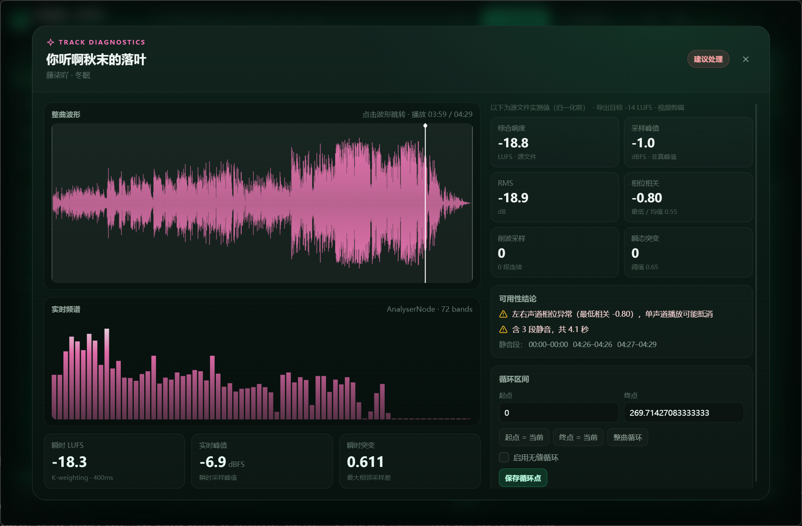

# 听风吟 · TFY BGM

专为视频剪辑打造的本地 BGM 音频素材库桌面客户端，基于 **Rust + Tauri 2** 构建。
分类扫描、收藏、检索、队列、场景排程、可视化诊断与全功能播放器全部在本地完成，离线可用；
曲库目录变更由系统级文件监听自动同步，无需手动重新扫描。
支持 **mp3 / m4a / flac / wav / ogg** 五种音频格式，切歌可交叉淡入淡出，
并能把同一路音乐同时送到多个输出设备、每路独立调音量；另提供本机 HTTP 开放接口，
方便 OBS、Stream Deck、直播脚本等外部项目接入控制。
界面为 `ui/` 下的 **Vite + Vue 3 + TypeScript**：扫描、文件操作与配置持久化集中在 Rust 核心库，
前端负责界面展示、Web Audio 播放、多设备路由与离线音频分析。

---

## 🖼 界面预览

### 曲库主界面


界面自上而下、从左到右分为四个区域：

| 区域 | 内容 |
| :--- | :--- |
| **顶栏** | 品牌标识与副标题；搜索框（匹配曲名、中英文分类名与目录名，按 `/` 聚焦）；「导入音乐」；排序切换（推荐 / 按曲名）；界面壁纸（渐变 / 静态图 / MP4 动态壁纸）；设置齿轮（打开「基本系统配置」：常规 / 播放 / 模型 / 第三方接入） |
| **左侧栏** | 浏览：音乐库、我的收藏、播放队列、节目单、**字幕生成**；曲库管理：重新扫描、切换曲库目录、打开曲库文件夹、恢复默认曲库；底部常驻显示曲库状态、当前目录与当前时段节目 |
| **主区** | 当前分类横幅（中英文标题、描述、曲目数，「全部播放」「随机试听」）→ 风格筛选栏（显示各分类曲目数，含「＋ 新增分类」）→ 曲目列表（标题、时长、喜欢按钮、分类标签与更多操作，勾选后浮出批量操作条；每行右键或「更多」菜单均可进入「字幕生成」）；切换到「节目单」时显示每日节目时间轴，节目行可展开歌曲、就地编辑；切换到「字幕生成」时通过搜索加入字幕生成记录列表，可试听、生成 / 预览 / 导出字幕 |
| **播放器** | 常驻底栏：封面（点击打开可视化诊断）、曲名（过长跑马灯）、艺人 / 专辑与分类、当前节目标签、收藏、循环点标记；循环模式、上一首 / 播放暂停 / 下一首、倍速列表；音量滑杆、播放输出（多设备路由、每路独立音量、淡入淡出时长）、导出设置（响度归一化与目标）、**桌面歌词开关**、导出音频、播放队列入口 |

### 播放队列


点击播放器右侧的队列按钮即可展开，面板浮于界面上方、背景自动虚化。
当前曲目高亮显示，播放中还会出现跳动的电平指示，每行带分类标签；
点击任意一行直接切歌；每行末的 `×` 移除单曲，顶部「清空」清空整个队列，两者都会二次确认，避免误操作。

### 节目单 · 场景排程


左侧栏「节目单」把一天切成互不重叠的时段。页面顶部实时显示当前时间、当前节目与下一档节目，
每档节目行展示时间范围、歌曲数量、到点音量与启停状态，进行中的节目带「进行中」标记。

- **浏览与编辑分离**：点击节目行或左侧箭头展开只读歌曲列表，列出每首歌的起止时间、时长与分类，
  正在播放的曲目会高亮并标注「播放中」；「编辑」按钮在该行下方就地展开编辑器，不跳离时间轴。
- **添加歌曲**：「添加歌曲」打开「歌单 → 歌曲」树形弹窗，可按歌单 / 曲名 / 艺人搜索、整组选择或多选后确定，
  节目内已用歌曲自动排除。
- **逐曲排期**：每首歌可单独设置节目范围内的开始 / 结束时间；左侧拖拽手柄调整顺序后时间槽按位置重新分配；
  「自动排期」按歌曲时长重新铺满整个节目时段；单曲「替换」保持原位置与时间不变。
- **互不重叠**：节目按本地时间每天执行，结束必须晚于开始且不能跨天；节目之间时间范围严禁重叠，
  前端保存前校验并提示，后端写入时再次拒绝重叠。
- **到点执行**：保存或启用节目后立即按当前时间对齐；时段内会拦截音乐库手动点播，
  当前歌曲播完后只循环本时段到点的歌曲，等下一首起始时间再切换，不会串到其它时段。

### 可视化诊断



点击播放器封面打开诊断面板：

- **整曲波形**：点击任意位置跳转，播放头与循环区间同步显示。
- **实时频谱**：`AnalyserNode` 72 段频谱，随播放刷新。
- **实时仪表**：瞬时 LUFS（K 加权 400ms 窗）与实时峰值（采样峰值），另附整曲最大跳变。
- **整曲分析**：BS.1770 综合响度、采样峰值、RMS、左右声道相位相关、削波采样、瞬态突变与静音段，
  并汇总为「可直接使用 / 可用，建议留意 / 建议处理」结论。
- **测量基准**：所有指标均以源文件为基准（归一化前）；导出目标响度仅作为对照显示，不参与测量。
- **循环区间**：可直接把起点 / 终点标记到当前播放位置，保存采样级 A/B 循环或整曲循环。

---

## 📦 仓库结构

| 内容 | 位置 | 说明 |
| :--- | :--- | :--- |
| 曲库音频 | `bgm/<分类>/*.{mp3,m4a,flac,wav,ogg}` | 文件名即曲名；外置存放，不打进 exe / 安装包 |
| 内置壁纸 | `assets/bg/` | 随包壁纸：`1.mp4`（动态）+ `1.thumb.jpg` 缩略图 + `2.jpg`（静态），经 `bundle.resources` 打进安装包 |
| 设备无关核心库 | `src-tauri/core/` | 目录扫描、ID3 标签解析与缓存、导入/重命名/移动/软删除、分类元数据、应用配置、节目单与循环点持久化、导出校验与 ffmpeg 响度归一化；可独立测试 |
| 分类默认模板 | `src-tauri/core/assets/categories.default.json` | 内置 6 个分类的默认文案与图标，编译期嵌入 |
| Tauri 应用层 | `src-tauri/src/` | 运行期状态、曲库根目录解析、系统级文件监听（`notify` + 30 秒兜底）、命令与资源授权 |
| 前端 | `ui/` | Vite + Vue 3 + TypeScript；`pnpm run build` 产物 `ui/dist/` 由 Tauri 内嵌 |
| 应用打包配置 | `src-tauri/tauri.conf.json` | 窗口、CSP、Asset Protocol（音频不打包） |
| 打包脚本 | `scripts/` | 绿色版 / NSIS 安装包 / Linux deb·rpm，统一产物命名并生成 SHA-256 校验值 |
| CI | `.github/workflows/package.yml` | 推 `v*` 标签自动构建全平台产物并发布 Release |
| 权限 | `src-tauri/capabilities/default.json` | `core:default` + 事件监听 + 无边框窗口拖拽/最小化/最大化/关闭 |
| 图标 | `src-tauri/icons/` | 由 `app-icon.svg` 生成的各平台图标 |
| 界面截图 | `assets/` | README 使用的四张预览图：主界面 GIF、播放队列、节目单、可视化诊断，不参与打包 |

```
tfy-bgm.exe ──┬─ Rust 扫描 / 文件监听 ──▶ LibrarySnapshot ──IPC──▶ Vue 3 界面
              ├─ 节目单调度 ──▶ 节目歌曲 + 音量
              ├─ 本机 HTTP API（127.0.0.1:8737）◀──▶ OBS / Stream Deck / 脚本
              └─ bgm/<分类>/*.{mp3,m4a,flac,wav,ogg}（exe 同级外置目录，不打进程序）
```

---

## 🗂 分类与目录规范

曲名直接取文件名（下划线 `_` 显示为空格），曲库内容完全由磁盘目录决定，
增删 / 替换音频后重新扫描即可生效。支持的扩展名：**mp3 / m4a / flac / wav / ogg**
（大小写不敏感）。同一目录下若同时存在 `track.flac` 与 `track.mp3`，稳定 key 相同，
扫描会保留优先级更高的格式（flac > wav > m4a > mp3 > ogg）并给出告警，避免同一曲目出现两次。

| 中文分类 | 目录名 | 适用剪辑场景 |
| :--- | :--- | :--- |
| **欢快** | `cheerful` | 生活 Vlog、开箱解说、美食探店、快节奏卡点 |
| **独处** | `solitude` | 深夜独白、治愈钢琴、学习工作、慢生活 |
| **回忆** | `memories` | 怀旧故事、毕业季、岁月光影、情感纪实 |
| **史诗** | `epic` | 燃向混剪、大片战歌、企业宣传、运动高光 |
| **古风** | `gufeng` | 国风雅韵、汉服文旅、仙侠武侠 |
| **乡村** | `country` | 乡野烟火、田园慢生活、度假风景 |

注册分类与展示文案以 `categories.json` 为准：首次启动会按内置模板生成该文件，
之后既可在界面中维护，也可直接用编辑器修改后点击「重新扫描」生效。
放入未注册目录（即 `categories.json` 中不存在的目录）或 `bgm/` 根目录的音频会被忽略，并在界面上给出告警。

### 分类维护

- **编辑分类**：右键点击任意分类标签（或曲目行中的分类标签）→ 「编辑分类」，可修改显示名称与主题色；
  目录名与已导入的音频文件保持不变。
- **新增分类**：点击风格筛选栏末尾的「＋ 新增分类」，或右键分类 → 「新增分类」；可指定目录名（留空则使用分类名称），
  应用会同步在曲库根目录下创建同名文件夹，之后即可向该分类导入音频。
- **本地文件维护**：分类配置保存在应用配置目录的 `categories.json`（见下方「运行时配置文件位置」），
  右键菜单中的「打开分类配置文件」会在文件管理器中定位该文件；字段包括 `id`（目录名）、
  `nameZh`、`nameEn`、`labelEn`、`color`、`icon`（界面图标名）、`title`、`description`。
  缺失字段会自动补全，损坏或为空时回退为内置分类。修改文件后点击左侧栏「曲库管理 → 重新扫描」即可刷新。
  每次新增 / 编辑分类以及重新扫描时，应用都会先重新读取该文件，手工编辑不会丢失。

---

## ⚙️ 基本系统配置

点击顶栏齿轮打开「基本系统配置」，分四个分组：

| 分组 | 配置项 |
| :--- | :--- |
| **常规** | 字体选择（扫描系统已安装字体，可搜索、可重新扫描）、开机自动启动、最小化托盘（与关闭按钮的「最小化托盘」联动）、开启 GPU 加速；Windows 额外提供 SMTC（默认关闭）、系统空间音效（默认关闭）、系统音频增强（默认开启）；Linux 额外提供 MPRIS2（默认关闭，仅 Wayland 会话支持） |
| **播放** | 程序启动时自动播放、音乐播放时不自动休眠或熄屏、开启音乐淡入淡出、输出设备列表（开关 / 独立音量 / 静音） |
| **模型** | ASR 模型目录（默认系统「下载」目录下的 `bgm-models`，可自定义）、下载地址（可自定义）、自动扫描到的 `.onnx` 模型列表、默认模型下载（可取消）与 sherpa-onnx 加载 / 释放 / WAV 识别 |
| **第三方接入** | API token、当前开放接口清单及说明、CORS 配置（仅本机 / 允许所有来源 / 自定义来源） |

偏好写入 `prefs.json`（模型目录与下载地址也在这里）；token 与 CORS 写入 `config.json` 的 `api` 段并立即生效。
关闭 GPU 加速需要重启应用（WebView 渲染后端只能在创建前确定）。

### ASR 模型

ASR 推理统一走 [sherpa-onnx](https://k2-fsa.github.io/sherpa/onnx/rust-api/index.html) 的 Rust API
（`OfflineRecognizer` + `OfflineQwen3ASRModelConfig`），不引入其他推理框架。

- 默认模型：`sherpa-onnx-qwen3-asr-0.6B-int8-2026-03-25`，仅支持 0.6B-int8；
- 模型目录默认为系统「下载」目录下的 `bgm-models/`：Windows 取「下载」文件夹
  （`FOLDERID_Downloads`，跟随系统重定位），Linux 取 `XDG_DOWNLOAD_DIR`（通常是 `~/Downloads`）；
  未定义下载目录时退到 `<用户主目录>/Downloads`。可在「模型」中更改或恢复默认；
- 进入「模型」分组时自动递归扫描目录下所有 `.onnx`，同一目录内的文件归为一个模型；
- 默认下载地址：`https://modelscope.cn/models/zengshuishui/Qwen3-ASR-onnx/tree/master/model_0.6B`，可在「模型」中自定义；
- 默认模型缺失时显示「下载」，下载清单固定为 `conv_frontend.onnx`、`encoder.int8.onnx`、
  `decoder.int8.onnx` 与 `tokenizer/`，不会下载 fp32 或 1.7B 版本；下载过程中可随时取消；
- 加载接口把上述四项分别填入 `conv_frontend` / `encoder` / `decoder` / `tokenizer` 后交给 sherpa-onnx；
- **下载完成后自动触发加载**，状态条显示「加载中 / 加载成功 / 加载失败」，失败保留完整原因并提供「重试加载」；同一模型已加载成功时不会重复加载；加载 / 释放也可手动执行；
- 模型加载后可在「模型」分组选择 WAV 文件做识别，结果显示在分组底部；所选 WAV 若为
  其他采样率，会在识别前自动重采样到 16 kHz。

### 字幕生成与桌面歌词

左侧栏「字幕生成」的音乐选择区不加载完整音乐库，只提供搜索框与搜索结果：输入关键词后
点选结果、或在音乐库中右键曲目 / 点击「更多」→「字幕生成」，都会把该曲目加入
「字幕生成记录列表」；记录列表与选中曲目区均可试听，每行右侧可把曲目移出记录列表。
待生成记录会随曲库快照对账（曲目消失即移除）；已生成的字幕记录在应用内重命名 / 移动曲目时
会随 key 一并迁移（文件监听发现的外部移动同样迁移），删除曲目则保留为可预览 / 导出 / 删除的孤立记录。
对记录中的曲目，非 WAV
（MP3 / FLAC / M4A / OGG）先用 ffmpeg 归一化为 16 kHz 单声道 PCM WAV，
再按目标时长（约 10 秒）切片调用已加载的 ASR 模型逐段识别：切点会在目标点前后
2.5 秒内吸附到能量最低的 20 ms 帧（换气 / 停顿处），避免把词切成两半，
生成带时间轴的字幕分段；归一化出的临时 WAV 在识别结束后自动删除，不会在配置目录累积。识别层另有一层兜底：送入引擎的 PCM 若不是 16 kHz，会先用带限
Lanczos 插值重采样（下采样时收窄截止频率以避免高频混叠），因此 ffmpeg 缺失时直接使用源 WAV、
或在「设置 → 模型」选择任意采样率的 WAV 识别，也都会统一到 16 kHz。生成过程推送分片进度；
成功后可切换预览 SRT / LRC 文本（选择写入偏好，重启后保持），并导出同名 `.srt` / `.lrc` 文件（默认文件名取曲目名）。
不支持的格式、ffmpeg 缺失 / 转换失败、模型未加载或 ASR 无结果都会给出明确错误。
字幕结果按曲目 key 持久化在应用配置目录的 `subtitles/` 下，重新进入页面仍可导出。

**记录检索**：记录列表有独立的检索框与状态筛选（全部 / 已生成 / 待生成）。关键词匹配曲名、文件名、
分类、艺人 / 专辑与字幕正文，多个空格分隔的词按「全部命中」过滤；曲目已移出曲库的孤立记录同样
可按字幕内容检索到，命中数量与总数同列。该检索与上方「搜索曲目」互不干扰，也不会触发曲库扫描。

**结果编辑**：在「结果预览」点击「编辑」后可切换「分段编辑」（逐条修改文字与起止时间，单位为秒，
支持插入 / 删除分段）与「原文编辑」（直接修改 SRT / LRC 文本）。保存时后端统一校验时间合法性
（非负、结束晚于开始、按起点排序）、折叠文本换行并校验单句长度（超限报错而非截断）；SRT 兼容
缺失序号行、`MM:SS,mmm` 简写与多行文本，LRC 兼容元数据标签（`[ar:]` / `[ti:]` 等，`[offset:]`
只作为元数据忽略、不参与计时）与一行多时间戳，结束时间按下一句起点（末句按字幕记录时长、
其次曲库时长）推导。无法识别的时间轴或标签会指出具体行号且不写盘，不会静默丢弃。字幕以
「临时文件 + rename」原子覆盖，保留原生成时间与曲目元信息，仅更新分段、SRT / LRC 文本与
`updatedAtMs`，记录列表标注「已编辑」。保存成功后预览、导出与已开启的桌面歌词立即同步
（歌词分段缓存失效后重新读取）；编辑期间禁止切换曲目、生成或导出，避免未保存的草稿丢失。

ASR 模型加载成功后，播放器右侧的「桌面歌词」开关才可用（未加载时禁用并提示先完成模型加载）。
开关状态写入偏好：下次启动在模型自动恢复成功后自动重新开启；点击悬浮窗的「×」或用
Alt+F4 等系统方式关闭窗口、以及释放模型，都会清除该状态（正常退出应用不会）。
开启后创建独立的透明置顶悬浮窗口，按播放进度高亮当前字幕行，并显示上一行 / 下一行；
当前行按词连续混色，已唱词随进度渐进过渡，跳转或调整样式后立即重算；倍速播放时悬浮窗按相同倍速本地推进，高亮不会漂移；
设置窗可将「已唱标记提前」设为不提前 / 1 秒 / 2 秒（默认 1 秒）：渲染时间轴整体前移，逐词标记与行切换同步提前，
抵消 ASR 字幕起点偏晚、句间空白被计入行时长以及跨窗口同步造成的标记滞后；选「不提前」即回到原始时间轴。
暂停、切歌、停止播放分别冻结进度、切换歌词、显示空闲提示。当前曲目尚未生成字幕时，
悬浮窗会提示前往「字幕生成」。

歌词窗口始终位于最顶层：创建后二次确认 Z 序、窗口失焦时重新声明，窗口自身每 3 秒巡检一次
（全屏应用 / 虚拟桌面切换可能把 topmost 降级），设置面板里也可手动「重新置顶」并查看状态。
按住窗口任意空白处即可拖动（歌词文本、设置面板空白处同样可拖），按钮 / 下拉框 / 滑杆等控件
会自动排除，不会误触拖动；窗口禁止最大化，双击拖动区域不会铺满屏幕。
点击工具栏的「Aa」打开贴在歌词条上方的独立设置悬浮窗，歌词条自身尺寸保持不变。
设置窗内可调歌词字号（12–64px）、高亮颜色、背景浓度、已唱标记提前量（0 / 1 / 2 秒）、锁定状态，以及**窗口宽度（420–1600）与高度（120–900）**；
字体下拉直接列出本机已安装字体（复用 `system_fonts` 扫描结果），使用系统原生弹层，可伸出设置窗。
设置窗完整显示全部控件、无需滚动；修改立即同步到歌词窗口并保存在窗口本地，
关闭设置窗或再次点「Aa」即可收起，关闭歌词窗口时设置窗一并关闭。
工具栏同时常驻 `A− / 字号 / A+` 步进入口，不打开设置窗也能直接调字号。
改动即时预览并保存在窗口本地，重启应用（或关闭后重新开启歌词窗口）仍生效；「恢复默认」同时还原尺寸与位置。
窗口默认 760×120（逻辑像素）并贴屏幕底部居中显示（距任务栏留白 32px），
拖拽边缘调整后的逻辑尺寸也会记住，与滑块设置共用一份偏好；滑块把窗口撑出屏幕时，
Rust 侧会把窗口自动拉回当前屏幕的工作区内（只钳制位置，不重置用户拖动的位置）。

点击标题栏关闭按钮会询问「关闭程序」还是「最小化托盘」；勾选「记住我的选择，下次不再提示」后，
选择结果写入 `prefs.closeAction`（`ask` / `quit` / `tray`），之后关闭按钮直接执行该动作。
选择最小化托盘会同时开启「常规 · 最小化托盘」并创建托盘图标（左键托盘恢复窗口）；
开启「最小化托盘」后，Alt+F4、任务栏关闭窗口等系统关闭也会隐藏到托盘并继续播放。
在设置里关闭「最小化托盘」时，已记住的「关闭到托盘」会退回为每次询问，避免关闭按钮创建出被关掉的托盘。

## ⚙️ 应用配置 config.json

品牌文案、界面文案与播放器行为参数都从应用配置目录的 `config.json` 读取。
首次启动会按内置默认值生成该文件；右键风格筛选栏 → 「打开应用配置文件」，
修改后点击左侧栏「重新扫描」热加载（窗口标题、标题栏与列表文案立即更新，无需重启）。

| 字段 | 说明 |
| :--- | :--- |
| `brand.title` | 顶栏品牌标题与文档标题 |
| `brand.subtitle` | 顶栏品牌副标题 |
| `brand.windowTitle` | 系统窗口标题，启动与热加载时应用 |
| `player.rates` | 倍速档位与循环顺序，如 `[0.75, 1, 1.25, 1.5, 2]` |
| `player.volumeStep` | `↑` / `↓` 与音量滑杆的步进 |
| `player.seekStepSeconds` | `←` / `→` 的跳转秒数 |
| `player.restartThresholdSeconds` | 当前曲目播放超过该秒数时，「上一首」先回到开头 |
| `player.maxAutoSkips` | 连续加载失败时最多自动跳过几首；`0` 表示不跳过 |
| `player.loadTimeoutMs` | 读取音频 Blob 的超时时间（毫秒） |
| `ui.all` / `ui.favorites` | 「全部」「收藏」页的 `title`、`labelEn`、`description`、`resultsTitle` |
| `api.enabled` | 是否启动本机开放接口，默认 `true` |
| `api.port` | 接口端口，默认 `8737`，只监听 `127.0.0.1` |
| `api.token` | 可选 Bearer token；为空表示不鉴权；非空时除 `/v1/health` 外的请求（含 SSE）都必须携带，可在「第三方接入」中修改 |
| `api.cors.mode` | 跨域策略：`local`（仅本机，默认）/ `any`（全部来源）/ `custom`（本机 + 自定义来源） |
| `api.cors.origins` | `custom` 模式下额外放行的来源，如 `["https://example.com"]`；最多 16 条，`*` 等价于 `any` |

`api.enabled` / `api.port` 在应用启动时读取，修改端口或启用状态需要重启应用；
`api.token` 与 `api.cors` 可在「第三方接入」中修改并立即生效。

`ui.*.description` 支持 `{categories}` 占位符，会替换为当前分类名称（以「、」连接）。
所有取值都会被自动收敛：空文案回退默认、数值夹到安全区间、倍速去重并限制在 `0.25`–`4.0`；
文件损坏时回退内置默认值，并在界面提示。

### 曲库根目录解析顺序

1. 环境变量 `TFY_BGM_DIR`（适合开发与可移动硬盘）；
2. 界面上「切换曲库目录」选择并持久化的文件夹；
3. 开发模式（debug）下的仓库根目录 `bgm/`；
4. **exe 同级的 `bgm/`**（绿色版默认曲库位置）；
5. 当前工作目录下的 `bgm/`；
6. 应用配置目录 `%APPDATA%\com.yuanjie.tfybgm\bgm`。

外置目录不存在时，程序会优先在 exe 同级创建 `bgm/` 并补齐分类子目录；若该位置不可写，则退到应用配置目录。
音频始终在外部，替换 / 增删文件后点「重新扫描」即可，无需重新打包。

左侧栏「曲库管理」可随时「重新扫描」「切换曲库目录」「打开曲库文件夹」；使用自定义目录时可「恢复默认曲库」。

---

## ✨ 功能

1. **本地曲库与分类检索**
   - 内置 6 个分类（可右键编辑名称与主题色、用 `＋` 新增自定义分类）、收藏夹、实时搜索（曲名 / 中英文分类名 / 目录名）。
   - 两种排序：推荐（默认）与按曲名（`Intl.Collator` 中文排序）。
   - 「推荐」排序下可拖动行调整顺序（仅内存，不写盘）。
2. **曲库文件管理（CRUD）**
   - **分类**：右键分类标签或曲目分类标签编辑名称 / 主题色，`＋` 或右键菜单新增分类，
     右键菜单可直接打开本地 `categories.json` 配置文件。
   - **新增**：顶部「导入音乐」选择多个音频（mp3 / m4a / flac / wav / ogg），复制到指定分类目录；同名自动追加序号，不覆盖已有文件。
   - **编辑**：行内编辑曲名与分类；曲名变化会重命名文件，分类变化会移动文件，收藏 key 自动跟随。
   - **右键菜单**：曲目行支持播放、顺序播放、随机播放、收藏 / 取消收藏、重命名文件、修改分类、
     导出音频与删除；多选时对所选曲目执行收藏、移动分类、导出与删除。
   - **删除**：单首或批量删除为软删除，文件移动到曲库根目录的 `.tfy-trash/<批次>/`，可手动恢复。
   - **批量**：表头全选/单选/Shift 连选，批量导出、批量移动分类、批量删除。
3. **音频导出**
   - 每首曲目与播放器均可导出音频，弹出系统原生保存对话框；开启归一化、ffmpeg 可用且目标为 mp3 时输出 mp3，
     关闭归一化、缺少 ffmpeg 或手动把目标扩展名改回源格式时按源格式复制，避免扩展名与内容不符。
     源与目标格式不同又无法归一化时会直接报错并说明原因。
   - 多选后可批量导出到指定文件夹，同名自动追加序号。
   - **响度归一化（默认开启）**：基于 EBU R128 / BS.1770 人耳感知响度，借助 ffmpeg 两遍 `loudnorm` 统一电平，
     避免不同素材在时间线上忽大忽小；默认按 **视频剪辑**（-14 LUFS）目标归一化。
   - **归一化目标**：可在导出设置中切换 **视频剪辑**（-14 LUFS）、**播客/访谈**（-16 LUFS）、
     **专注/冥想**（-20 LUFS）、**广播/影视**（-23 LUFS），真峰值与响度范围随目标同步调整。
   - 点选目标即按该目标导出；关闭归一化后仅复制原文件。
     实测同一素材在 -14 与 -20 LUFS 目标下输出相差约 6 LU。
   - ffmpeg 按 `TFY_FFMPEG` → exe 同级目录 → `PATH` 顺序查找；未检测到、目标不是 mp3 或处理失败时
     自动回退为原格式复制，并在导出结果中提示原因。
   - 复制后校验落盘字节数与源文件一致，失败会清理不完整文件。
4. **全功能播放器**
   - 播放 / 暂停、上一首 / 下一首、顺序 / 单曲 / 智能随机（见下）。
   - 默认 0.75x / 1.0x / 1.25x / 1.5x / 2.0x 倍速档位（可在 `config.json` 调整），点击倍速按钮从列表中选择。
   - 高精度进度条：悬停时间预览，按住拖动 Seek；整曲解码后进度响应即时。
   - 音量滑杆、静音、播放队列抽屉（单曲移除与清空均带二次确认）、当前曲目收藏。
   - 曲名过长时跑马灯滚动；处于节目单时段时，播放器额外显示当前节目标签。
   - 音频经 Asset Protocol 读取后由 Web Audio 解码为 `AudioBuffer` 播放，兼容 Linux WebKitGTK，并支持采样级 A/B 循环。
   - **切歌淡入淡出**：旧声部按设定时长（0–12 秒）线性淡出，新声部同时淡入；
     曲目自然播完切到下一首时，新曲也按同一时长淡入，列表播放不会硬切。
     暂停 / 恢复也有 80ms 短淡出，避免爆音。时长在「播放输出」面板或 `prefs.json` 的 `crossfadeSeconds` 调整。
   - **多输出设备**：同一路混音可同时送到多个物理输出设备（扬声器、耳机、虚拟声卡等），
     每路有独立音量与静音，互不影响；系统默认输出与额外设备都可单独启停。
     首次使用需授权一次音频设备访问（应用不录音），之后按应用记住授权。
   - 加载失败自动跳过（最多连续 3 首）并提示原因，失败时会停下来而不会无限循环切歌。
5. **曲库实时监听**
   - 基于系统级 `notify` 递归监听曲库目录，700ms 防抖后增量对比新增 / 删除 / 跨分类移动，并推送快照到界面。
   - 每 30 秒兜底校验一次，覆盖网络盘、休眠恢复等事件丢失场景；切换曲库目录时自动重建监听。
   - 扫描时读取音频标签（ID3v2 / Vorbis Comment / iTunes `ilst` / RIFF INFO）与时长，按「路径 + 大小 + 修改时间」缓存，重复扫描只解析新文件。
6. **智能随机与无缝循环**
   - 随机播放不是纯随机：同艺人 / 同专辑不连续、收藏与同风格加权、45 分钟内播过的曲目降权，长曲之后避免接短曲。
   - 任意曲目可设置 A/B 循环区间；播放器用 Web Audio `AudioBufferSourceNode` 的 `loopStart` / `loopEnd` 实现采样级无缝循环。
   - 循环点写入应用配置目录的 `loops.json`；重命名 / 移动曲目时自动迁移，删除曲目时一并清理。
7. **节目单 · 场景排程**
   - 左侧栏「节目单」按每日时间轴编排：每档节目设置名称、开始 / 结束时间、启用状态与到点音量，
     节目之间时间范围严禁重叠，由前端提示与后端校验双重拦截。
   - 页面顶部实时显示当前时间、当前节目与下一档节目；节目行带「进行中」「已停用」状态。
     点击节目行或左侧箭头展开只读歌曲列表；「编辑」在行下方就地展开，不跳离时间轴。
   - 「添加歌曲」通过「歌单 → 歌曲」树形弹窗搜索、整组选择或多选；歌曲可拖拽排序、单曲替换，
     并可为每首歌设置节目范围内的起止时间；「自动排期」按歌曲时长重新铺满整个节目时段。
   - 每秒校验系统时间；窗口最小化导致定时器节流时回看最近 2 分钟，休眠恢复后对齐当前节目里最晚一首已开始的歌。
   - 保存 / 启用节目后立即按当前时间对齐；时段内拦截音乐库手动点播，歌曲播完后只循环当前到点的歌曲，
     等下一首起始时间再切换，不会串到其它时段。
   - 配置写入 `schedule.json`，可在界面增删改、启停与立即应用，不打断正在编辑的页面。
8. **可视化诊断**
   - 点击播放器封面打开诊断面板：整曲波形（可点击跳转）、实时频谱（72 段）、
     瞬时 LUFS（K 加权 400ms 窗）、实时采样峰值与整曲最大跳变。
   - 整曲离线分析：BS.1770 综合响度、采样峰值（非真峰值）、RMS、削波采样、瞬态突变、静音段与左右声道相位相关。
   - 汇总为「可直接使用 / 可用，建议留意 / 建议处理」结论；所有指标以源文件（归一化前）为基准，
     导出目标响度仅作对照。
   - 可在波形上直接标记并保存循环起止点。
9. **收藏与偏好持久化**
   - 收藏、音量、静音、倍速、播放模式、排序、切歌淡入淡出、多输出路由、导出响度开关与归一化目标
     由 Rust 写入应用配置目录的 `prefs.json`。
   - 收藏使用稳定键 `分类/文件名主干`；重命名 / 移动分类时收藏自动迁移，替换同名文件不会丢失收藏。
10. **界面壁纸**
   - 顶栏调色板按钮可切换：默认样式、渐变蓝 / 绿 / 红，以及随包内置的两款壁纸（`assets/bg/1.mp4` 动态壁纸、`assets/bg/2.jpg` 雪山静态壁纸）。
   - 支持本地自定义壁纸：`jpg / jpeg / png / webp` 静态图与 `mp4` 动态壁纸，经系统文件对话框选择，路径写入 `prefs.json`。
   - 动态壁纸用静音循环的 `<video>` 铺满窗口，标签页隐藏时自动暂停；壁纸层压在面板下方，面板保持半透明毛玻璃，文字对比度不受影响。
   - 内置壁纸打包进安装包（`tauri.conf.json` 的 `bundle.resources`），资源缺失时对应选项自动隐藏。
11. **配置化与可维护性**
   - 品牌文案、界面文案、播放器行为参数集中在 `config.json`，分类文案与图标由 `categories.json` 维护。
   - 前端事件名、Tauri 命令名、播放模式等契约字符串统一收敛在 `ui/src/lib/constants.ts`，
     内置分类模板位于 `core/assets/categories.default.json`，修改文案不需要改代码。
12. **桌面体验**
   - 运行时不依赖 Node / pnpm（前端在构建期打包），离线可用；音频由 Tauri Asset Protocol 从本地曲库读取后播放。
   - 界面字体读取系统已安装字体，不请求任何远程字体：Windows 扫描系统字体目录、当前用户字体目录与注册表字体项，
     Linux 扫描 fontconfig 默认目录（`/usr/share/fonts`、`/usr/local/share/fonts`、`~/.local/share/fonts`、`~/.fonts`）
     及 `XDG_DATA_DIRS` 下的 `fonts`；选中字体缺少字形时按内置中文字体栈回退。
13. **本机开放接口**
   - 启动时在 `127.0.0.1:8737` 提供 HTTP JSON API 与 SSE 事件流，可查询曲库 / 当前状态、控制播放、
     调整主音量与每路输出，供 OBS、Stream Deck、直播脚本或其它项目接入。
   - 默认只监听回环地址；可在 `config.json` 配置端口与 Bearer token，详见下方「开放接口」。

### 键盘快捷键

| 按键 | 功能 |
| :--- | :--- |
| `空格` | 播放 / 暂停（未播放时从当前列表第一首开始） |
| `←` / `→` | 后退 / 前进（默认 5 秒，可在 `config.json` 调整） |
| `↑` / `↓` | 音量 +10% / -10%（步进可配置） |
| `M` | 静音 / 恢复 |
| `/` | 聚焦搜索框并选中当前关键词 |
| `Enter` | 搜索框内确认并退出输入（不影响中文输入法上屏） |
| `Esc` | 关闭诊断面板；关闭队列抽屉；清除批量选择；搜索框内清空搜索 |

---

## 🔌 开放接口

应用启动后会在 **`http://127.0.0.1:8737/v1`** 提供本机 HTTP API，默认只监听回环地址，
不需要任何额外进程；界面保持运行即可接受控制。端口与鉴权在 `config.json` 的 `api` 段配置。

所有响应统一为：

```json
{ "ok": true, "data": { } }
{ "ok": false, "error": "说明" }
```

失败时按语义返回状态码：`400` 参数错误、`401` token 缺失或错误、`403` 来源不被允许、
`404` 曲目或命令不存在、`409` 与节目单冲突或输出路数已满、`503` 界面未就绪、`504` 界面执行超时。

`api.token` 非空时，除 `/v1/health` 外的请求都需要带 `Authorization: Bearer <token>`（SSE 也可用 `?token=`）。
播放器面板的「播放输出 → 开放接口」会显示当前地址与接口状态（是否启用 token、是否已监听）。

浏览器来源默认只信任本机：应用自身 WebView（`tauri://localhost`）以及 `localhost` / `127.0.0.1` / `[::1]`
上的页面。**非本机网页默认会收到 `403`**，避免任意网站跨域读取曲库路径或控制播放；
可在「基本系统配置 · 第三方接入」里改为放行全部来源或追加自定义来源（`api.cors`）。
curl、Stream Deck、OBS 脚本这类不带 `Origin` 的客户端不受影响。

### 接口一览

| 方法 | 路径 | 说明 |
| :--- | :--- | :--- |
| GET | `/v1/health` | 服务状态、版本、是否就绪（无需鉴权） |
| GET | `/v1/state` | 当前播放状态快照（曲目、进度、音量、淡入淡出、输出路由、队列） |
| GET | `/v1/library` | 曲库根目录、分类与曲目列表，曲目额外带 `format` 字段（小写扩展名，如 `flac`） |
| POST | `/v1/library/rescan` | 重新扫描曲库 |
| POST | `/v1/play` | 播放指定曲目，body `{ "key": "cheerful/xxx", "queue": ["key", ...] }`，`queue` 可省略（默认整个曲库） |
| POST | `/v1/pause` / `/v1/resume` / `/v1/toggle` | 暂停 / 继续 / 切换播放 |
| POST | `/v1/next` / `/v1/previous` | 下一首 / 上一首 |
| POST | `/v1/seek` | 跳转，body `{ "seconds": 42.5 }` |
| POST | `/v1/volume` | 主音量，body `{ "volume": 0.8 }`（0–1） |
| POST | `/v1/crossfade` | 切歌淡入淡出时长，body `{ "seconds": 2 }`（0–12，0 为硬切） |
| GET | `/v1/outputs` | 输出设备、已启用的路由与每路音量 / 静音 |
| POST | `/v1/outputs` | 更新一路输出：`{ "deviceId": "...", "enabled": true, "volume": 0.5, "muted": false }` |
| GET | `/v1/events` | SSE 事件流，每秒推送一次 `state`，播放 / 切歌时立即推送 |
| POST | `/v1/command/{action}` | 通用入口，body `{ "params": { } }`；`action` 同上表去掉 `/v1/` 的名称 |

### 示例

```bash
BASE=http://127.0.0.1:8737/v1

curl -s $BASE/state
curl -s $BASE/library | jq '.data.songs[0]'
curl -s -X POST $BASE/play -H 'Content-Type: application/json' \
  -d '{"key":"cheerful/buttercup"}'
curl -s -X POST $BASE/volume -H 'Content-Type: application/json' -d '{"volume":0.6}'
curl -s -X POST $BASE/crossfade -H 'Content-Type: application/json' -d '{"seconds":3}'
curl -s -N $BASE/events        # 持续接收状态事件
```

```js
// Node 或本机页面（localhost）：先查曲目，再播放并把音量降到 60%
const base = 'http://127.0.0.1:8737/v1';
const library = await (await fetch(`${base}/library`)).json();
const song = library.data.songs.find((item) => item.format === 'flac');

await fetch(`${base}/play`, {
  method: 'POST',
  headers: { 'Content-Type': 'application/json' },
  body: JSON.stringify({ key: song.key }),
});

const events = new EventSource(`${base}/events`);
events.onmessage = (event) => {
  const { type, state } = JSON.parse(event.data);
  if (type === 'state') console.log(state.track?.title, state.position);
};

await fetch(`${base}/volume`, {
  method: 'POST',
  headers: { 'Content-Type': 'application/json' },
  body: JSON.stringify({ volume: 0.6 }),
});
```

多设备示例：`GET /v1/outputs` 拿到 `devices` 后，用 `deviceId` 打开某一路并单独设音量：

```bash
# 首次使用：解锁完整设备列表（等价于面板里的「读取设备列表」，不录音）
curl -s -X POST $BASE/command/outputs.unlock

curl -s -X POST $BASE/outputs -H 'Content-Type: application/json' \
  -d '{"deviceId":"<deviceId>","enabled":true,"volume":0.35}'
```

> 首次读取完整设备列表需要一次音频设备授权（Chromium 限制），可在播放器「播放输出」面板点击
> 「读取设备列表」完成；应用不会录音。Windows 上使用 WebView2 时支持多设备路由；
> 若运行环境不支持 `AudioContext.setSinkId()`，界面会明确提示并回退为仅系统默认输出。

状态快照的主要字段：`playing`、`position`、`duration`、`volume`、`muted`、`rate`、`playMode`、
`crossfadeSeconds`、`track`（含 `key / title / category / format / artist / durationMs`）、
`queue.length / index`、`outputs[]`（每路 `deviceId / label / volume / muted / enabled`）。

---

## 🚀 开发与构建

### 环境要求

- Rust **1.90+**（`rustup` 安装稳定版即可）。
- **Node.js 20+ 与 pnpm 11**：仅构建期需要，用于 Vite + Vue 3 + TypeScript（推荐 `corepack enable` 启用 pnpm）。
- **ffmpeg（可选）**：导出响度归一化默认开启，按 `TFY_FFMPEG` → exe 同级目录 → `PATH` 查找；
  未安装时导出仍可用，但会回退为原文件复制。
- Tauri 2 桌面依赖：
  - **Fedora**
    ```bash
    sudo dnf install webkit2gtk4.1-devel gtk3-devel libsoup3-devel \
      javascriptcoregtk4.1-devel openssl-devel librsvg2-devel \
      libappindicator-gtk3-devel gcc gcc-c++ pkgconf-pkg-config
    ```
  - **Debian / Ubuntu**
    ```bash
    sudo apt install libwebkit2gtk-4.1-dev build-essential curl wget file \
      libxdo-dev libssl-dev libayatana-appindicator3-dev librsvg2-dev
    ```
  - **macOS**：Xcode Command Line Tools。
  - **Windows**：Rust MSVC toolchain + Visual Studio Build Tools（勾选「使用 C++ 的桌面开发」）+ WebView2 Runtime（Win10/11 一般已预装）。
- 音频由系统 WebView 解码，Linux 上如遇无声 / 无法拖动进度，请补装 GStreamer 插件：
  `sudo dnf install gstreamer1-plugins-good gstreamer1-plugins-ugly`（Debian/Ubuntu 对应 `gstreamer1.0-plugins-good` / `-ugly`）。
- **多输出设备**依赖 WebView 支持 `AudioContext.setSinkId()`：Windows WebView2（Chromium 110+）可直接使用；
  Linux WebKitGTK 与 macOS WKWebView 未必支持，缺失时应用会自动降级为仅系统默认输出并在面板中说明。
- 播放格式（mp3 / m4a / flac / wav / ogg）由 WebView 的解码器决定；Windows WebView2 均原生支持，
  Linux 需要对应的 GStreamer 插件。

### 启动开发版

先在仓库根目录安装前端依赖：

```bash
corepack enable            # 首次使用 pnpm 时
pnpm install               # 安装根工作区与 ui/ 的全部依赖
```

然后任选一种方式启动：

```bash
# 方式一：Rust 原生 CLI（推荐，首次需安装）
cargo install tauri-cli --version "^2" --locked
cd src-tauri && cargo tauri dev

# 方式二：官方 CLI（仓库根目录执行）
pnpm dlx @tauri-apps/cli@^2 dev
```

`tauri.conf.json` 已配置：

- `beforeDevCommand: "pnpm run dev"` — Tauri 自动启动 Vite（`http://localhost:1420`），Vue 组件改动热更新；
- `beforeBuildCommand: "pnpm run build"` — 打包前自动执行 `vue-tsc` 类型检查与 Vite 生产构建；
- `frontendDist: "../ui/dist"` — 生产产物目录。

Rust 改动仍由 Tauri 自动重编译；只改前端时热更新即可，不需要重启窗口。

### 打包与分发

音频不进入 exe，也不进入安装包；程序运行时从外置 `bgm/` 读取。
绿色版包里的 `bgm/` 与 exe 并排，属于外置文件，整个文件夹可以替换或删除。

#### 方式一：绿色版（exe + 外置 bgm，推荐）

只编译 exe（不需要 Tauri CLI，但要先构建前端）：

```powershell
pnpm run build
cd src-tauri
cargo build --release
```

产物为 `src-tauri/target/release/tfy-bgm.exe`。手动放置时，在它同级放一个 `bgm/` 目录（首次启动也会自动创建并补齐分类子目录）：

```
tfy-bgm/
  tfy-bgm.exe
  bgm/
    cheerful/
    solitude/
    memories/
    epic/
    gufeng/
    country/
```

更推荐从仓库根目录一键组装并压缩，**默认会把仓库的 `bgm/` 一起复制**，解压即带曲库：

```powershell
# 自带曲库的绿色版（约 350 MB）
powershell -ExecutionPolicy Bypass -File scripts/package-portable.ps1

# 只要空曲库的精简包（约 3.7 MB），启动后自己指定曲库目录
powershell -ExecutionPolicy Bypass -File scripts/package-portable.ps1 -EmptyBgm
```

产物：

```
dist/
  tfy-bgm-1.0.0-windows-x64-portable.zip   ← 对外分发这个
  SHA256SUMS.txt                           ← SHA-256 校验值
  tfy-bgm/                                 ← 组装目录（exe + bgm\），可直接运行调试
```

打包脚本的几条约定：

- 构建前会先执行 `pnpm run build`（需要 Node.js 20+ 与 pnpm），确保 `ui/dist` 与 exe 同批次更新。
- `-WithBgm` 仍可传入，等同于默认行为。
- 重复打包只更新 exe / 说明文件，会保留 `dist\tfy-bgm\bgm` 里已有的曲库；需要从仓库重新同步时，先删除该 `bgm` 目录。
- `-EmptyBgm` 检测到已有音频（mp3 / m4a / flac / wav / ogg）时会拒绝执行，避免误删曲库。
- `-SkipBuild` 复用 `src-tauri\target\release\tfy-bgm.exe`，只重新组装与压缩；`-NoZip` 只组装不打 zip。
- 检测到 `dist\tfy-bgm` 下的程序正在运行时会提示先关闭，避免覆盖失败。
- zip 内是单层 `tfy-bgm/` 目录，解压后直接得到 `tfy-bgm.exe` 与 `bgm/`；空曲库包也会保留分类空目录。条目分隔符按规范写成 `/`，中文名按 UTF-8 存储并置 UTF-8 标志位，跨平台解压不乱码。
- `dist\` 里旧版本的产物不会自动清理，`SHA256SUMS.txt` 也只覆盖当前版本，发版前顺手删掉旧文件，避免误传。

目标机器需要 WebView2 Runtime（Windows 10/11 通常已自带；缺失时安装微软官方运行时即可）。

#### 方式二：NSIS 安装包

```powershell
cargo install tauri-cli --version "^2" --locked   # 首次安装

# 构建 + 归档到 dist\tfy-bgm-<版本>-windows-x64-setup.exe
powershell -ExecutionPolicy Bypass -File scripts/package-installer.ps1
```

脚本内部执行 `cargo tauri build --bundles nsis`，再把产物复制成规范名。`-SkipBuild` 可复用已有构建，但要求产物版本号与 `tauri.conf.json` 一致，避免把旧版本改名当成新版本发出去。

安装包不包含音频，体积与普通桌面应用相当；默认按当前用户安装到可写目录，首次启动会在 exe 同级创建 `bgm/`，也可通过「切换曲库目录」指向任意位置。

> 直接 `cargo tauri build`（不带 `--bundles`）会按 `targets: "all"` 尝试 NSIS 与 MSI；MSI 依赖 WiX，日常分发用 NSIS 即可。

#### 方式三：Linux 安装包（deb / rpm）

deb / rpm 无法在 Windows 上交叉构建，需在 Linux 上执行（或放进 CI 矩阵）：

```bash
bash scripts/package-linux.sh                    # 默认两种都打
bash scripts/package-linux.sh deb                # 只打指定格式
SKIP_BUILD=1 bash scripts/package-linux.sh rpm   # 复用已有构建
```

产物：

```
dist/tfy-bgm-1.0.0-linux-amd64.deb
dist/tfy-bgm-1.0.0-linux-x86_64.rpm
```

- **不需要 Fedora，也不需要 `rpmbuild`**：`deb` 与 `rpm` 都由 Tauri 内置的纯 Rust 打包器直出（deb 用 `flate2` + `tar`，rpm 用 `rpm` crate），全程不调用 `dpkg-deb` / `rpmbuild`。只要这台机器能编译 Tauri（装好「环境要求」里的 WebKitGTK 依赖），两种包都能打。
- 在 Ubuntu 24.04 上构建，产物要求 **glibc ≥ 2.39**（Ubuntu 24.04+ / Debian 13+ / Fedora 40+）；更老的发行版不在支持范围内。
- 想在 Fedora 上验证安装效果，可以 `podman run --rm -it -v $PWD/dist:/mnt fedora:latest dnf install -y /mnt/tfy-bgm-*.rpm`。
- 首次需 `cargo install tauri-cli --version "^2" --locked`。
- rpm 文件名去掉了 release 段以保持四段统一，包内元数据仍是 `Release: 1`；将来若直接拿构建目录里的产物做 dnf 仓库，原名也仍然可用。

#### 产物命名规范

统一为 `tfy-bgm-<版本>-<平台>-<架构>[-<类型>].<扩展名>`：

| 平台 | 文件 |
| --- | --- |
| Windows 绿色版 | `tfy-bgm-1.0.0-windows-x64-portable.zip` |
| Windows 安装版 | `tfy-bgm-1.0.0-windows-x64-setup.exe` |
| Linux DEB | `tfy-bgm-1.0.0-linux-amd64.deb` |
| Linux RPM | `tfy-bgm-1.0.0-linux-x86_64.rpm` |

- 版本号唯一来源是 `src-tauri/tauri.conf.json`，脚本会校验 `Cargo.toml` 的 `[package].version` 是否一致，不一致直接报错，避免产物名与实际版本脱节。
- 架构按平台惯例：Windows `x64` / `arm64`，deb `amd64` / `arm64`，rpm `x86_64` / `aarch64`——三者指同一架构，不要写成 `64bit`。
- rpm 官方命名是 `name-version-release.arch.rpm`，这里按要求统一成四段；`Release` 保留在包元数据里，`createrepo` 读的是 header，改名不影响索引。
- `SHA256SUMS.txt` 与 `sha256sum -c` 兼容（小写十六进制、两个空格、LF 换行），Windows 与 Linux 产物可以写进同一份。

#### 用 GitHub Actions 打包

`.github/workflows/package.yml` 先用 `plan` 作业校验标签版本并解析勾选项，再按选择的包与架构展开 `windows` / `linux` 矩阵作业，最后由 `release` 发布，产物命名与本地脚本完全一致：

```bash
git tag v1.0.0
git push origin v1.0.0
```

推 `v*` 标签会构建 **x64 全平台**并自动创建 Release，附上全部产物和一份合并的 `SHA256SUMS.txt`；标签名（去掉 `v`）必须等于 `tauri.conf.json` 的 `version`，否则 `plan` 直接失败，不会白跑构建。

也可以在 Actions 页面手动 `Run workflow`，勾选要打的包和架构，只构建不发布，产物在运行页面底部下载：

- **包**：Windows 绿色版 / Windows 安装版 / Linux deb / Linux rpm 可任意组合；没勾选的包不编译，对应作业也不会启动。
- **架构**：`x64`（默认）/ `arm64` / `both`。arm64 走原生 ARM 运行器（`windows-11-arm`、`ubuntu-24.04-arm`），不做交叉编译；首次运行要重新编译依赖，比 x64 慢。arm64 只用于手动构建分发，标签发布仍只出 x64。
- **曲库**：`empty-library` 跳过曲库——仓库里 `bgm/` 约 350 MB，带曲库的 zip 有 346 MB，私有仓库会明显消耗 Actions 存储配额。

几点说明：

- 只勾绿色版时不安装 `tauri-cli`；同时勾安装版时先出 NSIS，再复用同一份带 `custom-protocol` 的 exe 组装绿色版，省掉一次前端构建与 Rust 增量检查。
- 缓存按「作业 + 架构」分开：`tauri-cli` 与 Rust 依赖命中后直接跳过编译，`windows` / `linux`、`x64` / `arm64` 互不干扰。
- `plan` 和 `release` 跑 `ubuntu-slim`（1 核容器，分钟数远低于 4 核 VM）；打包必须用完整 VM——slim 镜像里没有 gcc 与 WebKitGTK、容器是非特权的、单 job 还有 15 分钟上限，Tauri 全量编译一定超时。
- artifact 只上传最终安装包（zip / exe / deb / rpm），`dist/tfy-bgm/` 组装目录不进 artifact；只保留 3 天（`retention-days: 3`）。
- Linux 用 `ubuntu-24.04`，产物只支持 glibc ≥ 2.39 的系统（Ubuntu 24.04+ / Debian 13+ / Fedora 40+），更老的发行版不在支持范围内。
- 打包不依赖任何 deb/rpm 工具链，workflow 里的 apt 步骤只装编译依赖（WebKitGTK 等）。
- 工作流只在 GitHub 上生效；当前 `origin` 是 Gitee，需要先推到 GitHub 镜像仓库才会触发。

---

## 🧪 测试与检查

```bash
cd src-tauri

cargo test -p bgm-core                 # 扫描 / 偏好 / 导出单元测试
cargo clippy -p bgm-core --all-targets -- -D warnings
cargo fmt --all -- --check
cargo check --workspace                # 需要上面的 WebKitGTK 等系统依赖
```

`bgm-core` 不依赖 Tauri，可在无图形依赖的环境（如 CI 容器）里独立测试业务逻辑。

---

## 🔐 架构与安全

- **状态与命令**：`AppState` 持有偏好（`parking_lot::RwLock`）与最近扫描结果；
  前端只能通过命令读取快照、保存偏好、切换 / 扫描曲库、导入 / 编辑 / 移动 / 删除曲目、
  导出音频以及保存节目单与循环点。
- **偏好校验**：前端提交的偏好会经过 `Prefs::normalize_with_rates`（音量 clamp、
  倍速白名单取自 `config.json` 的 `player.rates`、收藏去重与长度限制）；
  曲库目录只能由专门命令修改，普通偏好保存不能覆盖。
- **应用配置**：`config.json` 的品牌文案、数值参数与 `ui` 文案都会经过
  `AppConfig::normalize`；空文案回退默认、数值 clamp 到安全区间、倍速去重并限制在 `0.25`–`4.0`。
  窗口标题由配置驱动，热加载失败只提示告警，不影响曲库使用。
- **分类配置**：新增 / 编辑分类由 Rust 校验名称与目录名必须是单个普通路径分量，
  主题色必须是 `#RRGGBB`，同名分类与重复目录名会被拒绝；配置写入应用配置目录的
  `categories.json`，手工编辑后重新扫描生效。
- **最小权限**：`capabilities/default.json` 仅启用 `core:default` 与无边框窗口所需的
  拖拽、最小化、最大化、关闭 4 项 window 权限；原生文件夹选择、保存对话框与「打开目录」
  全部在 Rust 侧调用插件，不向 WebView 暴露插件权限。
- **多输出授权**：Chromium 只有在获得音频设备权限后才会返回完整输出设备列表。
  应用仅用 `getUserMedia({ audio: true })` 解锁枚举，拿到列表后立即 `stop()` 所有音轨，
  不录音、不落盘；权限按应用持久化，用户可在「播放输出」面板查看状态。
- **开放接口**：HTTP 服务只绑定 `127.0.0.1`，不监听局域网；`api.token` 非空时除健康检查外的请求
  （含 SSE）都要带 Bearer token。可执行的动作由前端白名单 `runAction` 限定，
  接口不能读写任意文件，也不能修改曲库目录。
- **资源授权**：Asset Protocol 仅授权当前曲库根目录（递归），可播放路径限定在扫描结果内。
- **CSP**：默认仅允许本地脚本 / 样式，`media-src` 允许 `asset:` 与 `http://asset.localhost`，
  不加载远程脚本、字体或图片。
- **写操作安全**：前端只能提交曲库快照中的 key 与分类 id；实际路径由 Rust 用
  「曲库根目录 + 注册分类 + 文件名」重新推导，并校验文件名必须是单一普通路径分量，
  拒绝路径穿越；重命名冲突直接报错，不覆盖已有音频。
- **节目单校验**：后端保存节目前会规范化时间与歌曲字段，并把歌曲起止时间裁剪到所属节目范围内；
  节目之间的时间重叠会被直接拒绝，避免同一时刻触发多档节目。
- **导出安全**：导出目标由系统保存对话框确定；复制后做大小校验，源路径由曲库快照推导而非前端路径。
  ffmpeg 以参数数组直接启动、不经过 shell，导出路径不会参与命令拼接。
- **删除可恢复**：删除采用软删除，文件移动到 `<曲库根>/.tfy-trash/<批次>/`，
  扫描器忽略该隐藏目录；批量删除前会弹出系统确认对话框。

### 运行时配置文件位置

由 Tauri `app_config_dir` 决定，五个文件并列存放：
`config.json`（品牌/文案/播放参数/开放接口）、`prefs.json`（偏好、淡入淡出、多输出路由）、
`categories.json`（分类）、`schedule.json`（节目单）、`loops.json`（循环点）。

- Linux：`~/.config/com.yuanjie.tfybgm/`
- macOS：`~/Library/Application Support/com.yuanjie.tfybgm/`
- Windows：`%APPDATA%\com.yuanjie.tfybgm\`

任一文件损坏或缺失时都会回退为对应默认值，不会阻止应用启动；
`config.json` 与 `categories.json` 修改后可点「重新扫描」热加载，
`schedule.json` / `loops.json` 由界面操作维护，`prefs.json` 由应用自行维护。

---

## 📄 许可与免责声明

- 代码与文档采用 **Apache License 2.0** 授权（见 `LICENSE`，Copyright 2026 YuanJie）。
- **音频素材版权归原权利人所有**。本仓库不附带任何音频授权，
  `bgm/` 下的音频文件不属于 Apache-2.0 授权范围。
- 素材仅供个人学习与剪辑练手；商业发布前请自行向版权方取得授权。